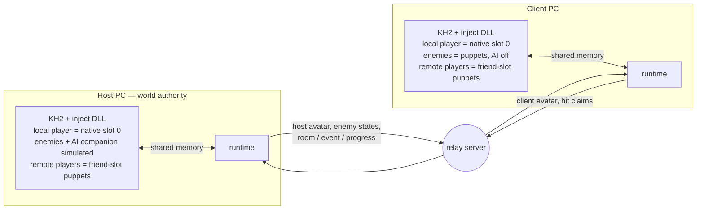
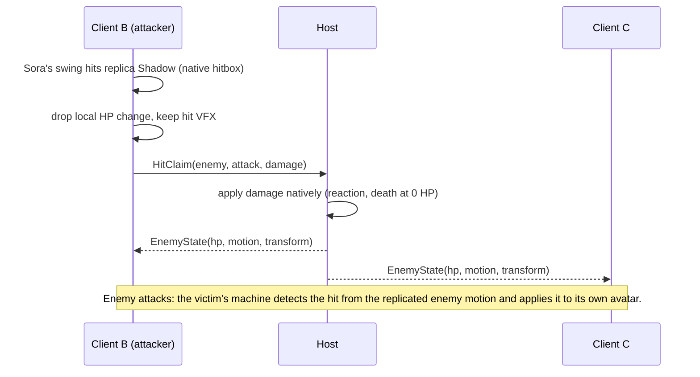

# Online Co-op Plan

> **Status:** plan of record established 2026-10-01; current-state refresh
> 2026-10-20 against main `2ed98fa`. Supersedes the Track A
> milestones M4–M8 in `IMPLEMENTATION_BACKLOG.md` and the authority and actor
> model sections of `kh2_three_client_coop_design.md`. Work is tracked in the
> Linear project **KH2 Multiplayer** (vuhlp workspace); this doc holds the
> design, decisions, risks and phase gates. D16 / prologue design added
> 2026-10-18 against main `33885e3`; older evidence below keeps its original scope.
>
> **Direction (2026-10-14):** [D14](#decisions) supersedes D13's work
> selection: one host brain for every enemy, a story route that three players
> can play, and a lighter definition of done. Next milestones, in order:
> 3-player playable co-op (James playtests), then PvP, then a hosted
> "Minecraft server" mode.

## Current implementation and qualification (2026-10-20)

Current compatibility is protocol **29**, AvatarBridge **4** and WorldBridge
**12**. Use a matching product set; protocol numbers in dated results below
identify those historical runs, not today's compatibility. The preview accepts
only the verified Steam Global executable (`9002b2de`); Steam relay-only and ENet
share the session policy. This is development preview software, with no complete
playthrough or public-server acceptance claim.

The local-primary actor model is implemented: each human controls native slot 0
on their own PC, with other humans represented by friend-slot puppets. Ordinary
co-op supports up to three network seats; the checked prologue layout currently
admits two. The launcher offers Roxas or Sora; the core opening keeps a Roxas
host and permits a Roxas or Sora friend. Other playable profiles and arbitrary
host replacement remain requirements, not delivered roster support.

Two-instance loopback evidence covers first-field construction, the Armor Shop
reloads, the first Sandlot door, mixed-profile reconnect, seat colors and the
Sandlot duel. Later checked sites include the Day-6 Mansion/Back Alley ambushes,
Station of Calling, the Old Mansion front and its Day 1 Dusks, the Woods (seat 1
steps aside at release), the Back Alley after the ambush, the Basement Hall
after Axel, and the Day 3 Sandlot and Station of Serenity Dusks. These are
separate bounded runs, not one continuous New Game route. Unchecked fields and
sessions that start by loading a save there remain native solo until the next
checked site; the Back Alley ambush's object-309 binding can diverge, and the
Twilight Thorn boss fight is not yet qualified. See [party setup](PARTY_SETUP.md) and the
[encounter checklist](PROLOGUE_ENCOUNTERS.md).

Roxas logical downing, Triangle revive, delayed waves and host-led native
Continue have bounded Day-6 loopback evidence ([downed/revive](DOWNED_REVIVE.md));
native kills stand in for combat in that proof. The native party HUD displays
remote owner HP/MP and portraits. A separate two-Sora loopback shows each owner
casting Fire, spending MP and naturally refilling while the opposite HUD agrees
([native HUD](NATIVE_PARTY_HUD.md), [guest Magic](NATIVE_GUEST_MAGIC.md)).
These do not establish two-PC prologue, reciprocal HUD or whole-route acceptance.

The current route gate remains **New Game / Roxas Days 1-6 -> Sora's TT first
visit -> Yen Sid -> HB 1 -> world map/Gummi -> LoD 1 -> Shan-Yu**, on two PCs through
native doors with both players active. Opening-scene friend representation,
unqualified encounters/profiles and the two-PC route remain open. PC2 access
(VUH-2339) is a dependency recorded by the current evidence. The dated October 8
snapshot below is retained as history; use this summary and linked feature docs
for current behavior and limits.

## Product principle: character-agnostic co-op

James, 2026-10-18: “that is my goal overall, like any set of character should
work, not just sora and sora2”. **Any combination of playable characters for
the host and friends is the target, from the opening scene.** Roxas+Roxas and
Sora+Sora are first steps, not the shape of the feature. Character identity is a
per-player choice; world/story authority belongs to a connection, not to Sora or
Roxas. Shared combat, progress, camera, downed/revive and transitions must use
that ownership contract. A slice limited to one body or story role states its
technical reason, scope and exit criterion; it must not make that limit a
general multiplayer rule.

## Goal

Two or three players, each on their own PC with their own copy of KH2FM (Steam
Global), play together online: same rooms, same enemies, same story beats, each
with their own camera and full controls, joining before the opening scene of
the Roxas prologue. Qualify Roxas+Roxas, then a Roxas host with Sora and
party-member friends, then the full keyblade trio/world cast. A later optional
phase replaces the host's story Roxas too, such as Donald+Goofy. Every qualified
profile uses the same selection/ownership contract; duplicate choices work. See
the [D16 design](#prologue-co-op-and-playable-cast-vuh-2450) below.

## Prologue co-op and playable cast (VUH-2450)

**Design, 2026-10-18; source baseline main `33885e3`.** James requires multiplayer
from the beginning and any playable friend in Twilight Town: “two roxas's,
roxas and sora, roxas and goofy, doland, riku, etc. anyone we can make playable
that early lol”. His optional stretch is replacing the host's Roxas as well,
including Donald+Goofy. Those requirements amend D15's starting point and bring
the first roster slice onto the route critical path. The implementation policies
below are proposed for lead review; this design does not claim new live proof.
No PC was accessed for this design.

### Starting together, before Day 1 control

The milestone [VUH-2337](https://linear.app/vuhlp/issue/VUH-2337) becomes
**New Game / Roxas Days 1–6 → Sora's TT first visit → Yen Sid → HB 1 → world
map/Gummi → LoD 1 → Shan-Yu**, in one two-PC session through native doors and
story transitions. Both players join before the opening is released. Profiles
are chosen and acknowledged **before the first scene**, including
the friend's chosen identity in the first engine-driven scene and first field.
Roxas+Roxas is the first qualification, Roxas+Sora the next; each admitted party
profile must meet the same opening contract. Prerendered movies retain their
original footage. Joining after Sora wakes, a solo prologue, or a decorative
second actor does not meet this gate. Each player must move, fight and take damage.

[VUH-2338](https://linear.app/vuhlp/issue/VUH-2338) owns the new starting inputs.
Its read-only inventory found `FM-00` at Day 3, `FM-01` at Day 6 start and
`FM-02` at the Day-6 Computer Room; **none is a beginning-of-game fixture**.
Keep `tools/scenario/scenarios/boot_fm02.json`,
`tools/scenario/scenarios/pilot_axel_fm02.json` and
`tools/rig/route_pilot/routes/tt1_solo.json` for short
Mansion/Axel rehearsals, labelled Day-6 coverage. Keep the existing PC1 boot
capture and slot inventory as valid evidence for those unchanged inputs.

For opening acceptance use **New Game on both accounts**, with the same native
difficulty and host-owned opening choices. Connect/select/readiness must be
available before the opening scene initializes: latch the roster and party
intent before construction, then release input only after both first-field
arrivals and actor/status bindings are acknowledged. Do not wait for an avatar
pose to discover the selected kit; the old remote-kit mode needs a second load
and cannot satisfy first-frame admission. If title-time networking is not yet
available, adding it is part of VUH-2464, not permission to play Day 1 alone.

**Opening fixture (PC1, run `20261018-141748`).** `tools/scenario/scenarios/newgame_first_field.json`
(from its `.gen.py`) is the VUH-2464 opening: clean boot, NEW GAME,
Standard / vibration ON / Yes (the default rows; the first menu ignores input
for about 7 s), then Cross only while the field gate is closed. No save is
loaded or written. The opening is deterministic by inject game frame:
2/1 evt 52 (movie, from frame 1) → 2/1 evt 56 (TT title, 11,987) → 2/2 evt 63
(Usual Spot, voiced, 13,474) → 2/7 evt 106 (19,205) → **first control at 2/7
evt 95, Market Street: Tram Common, frame 19,568**: Roxas (`P_EX110`, 20 HP)
at (−2290, 0, −1616) with the native move/jump tutorial box and his HUD. The
field gate also opens for single frames between event loads (11,986, 13,473,
19,204); those aren't control. Movies run near 30 game frames/s, so the first
control frame comes about 10 minutes after Yes. The run's `first_field_progress.json`
holds the story, program and personal ranges at that point.

Prefer New Game over fabricating a save. If an opening fixture is later needed
for speed, make it from a legitimately obtained copy in an isolated rig fixture
location with explicit provenance and an approved load path. No edits to either
account's protected save folder and no automated in-game save. The existing
account-B container is only a loadability rehearsal, not proof of a Day-1 start.
The host's shared progress allowlist remains authoritative; it must not copy
character records, inventory, EXP or munny. Route-start evidence records both
initial story states, difficulty, kit choices and protected hashes.

### What exists, and what counts as playable

VUH-1513 is **partly proved, not a fresh Roxas moveset task**. Its “Playing as
Roxas” clip (`20261006-223600`) and DLL-owned run `20261006-233415` show the
native `P_EX110` player; `20261007-011457` shows a remote Roxas puppet. The latter
passed feature checks but failed fixture teardown. Later per-seat run
`20261007-090953` showed a Roxas local player and correctly neutralized Roxas
clones among three players in GoA/Borough, with private clone HP. Mickey party-kit
run `20261007-115923` also exists. These are bounded world-4 results, not evidence
of prologue doors, menu safety, dual-wield, Riku or Roxas revive.

Sources: `docs/PLAYER_KITS.md` (including its limits), `docs/PARTY_SETUP.md`
(“Per-seat kits”), `common/include/kh2coop/PlayerKits.hpp`, and the evidence
comments/attachments on [VUH-1513](https://linear.app/vuhlp/issue/VUH-1513).
The table admits Sora `0x54`, Roxas `0x5A` and party-only Mickey `0x5B`;
dual-wield Roxas `0x323` is listed but **unqualified**. Riku has no admitted row.
The older standalone player-kit path retains its own world/native-player
checks. The separate checked prologue ingress in `inject/src/PrologueParty.cpp`
and `common/include/kh2coop/PrologueSeats.hpp` now admits Roxas and Sora with
agreed profiles and private status. It does not qualify every prologue field,
opening scene or roster entry; see `PARTY_SETUP.md`, "Prologue layout".

A **playable profile** means local input drives that character's own supported
movement and attacks, with camera/lock-on, weapons, HUD, private remote status,
hit ownership, downed/revive, doors and event recovery working. It includes a
capability list and qualified contexts. A model swap, animation replay or an NPC
following its AI is insufficient. Choose from qualified profiles before New
Game/join; each seat may choose the same character. Missing or incompatible
profiles refuse readiness with a reason, never silently substitute Sora.

| Profile / phase | Prologue feasibility, first delivery and remaining gate |
|---|---|
| Roxas friend | Implemented at checked prologue sites, with two-instance first-field, door and selected encounter evidence under VUH-2464/2466. Opening-scene representation, unqualified fields and the continuous two-PC route remain open. |
| Sora friend | VUH-1512 implements selection, native body loading, first-field/reload/first-door construction, reconnect and refusal messages, with loopback evidence. Opening-scene representation and the two-PC route remain open. No story unlock is required by design. |
| Donald, then Goofy friend | Plausible, unproved: both exist in installed game data, but neither is a player-class kit or a qualified human profile. VUH-1514 first proves native friend-actor input/attack, then opening placement, camera/HUD, HP, actions, downed and doors. They need not wait for full Riku or the long route gate. A missing TT party slot is an actor-layout problem, not a story-unlock restriction. |
| Riku friend / full keyblade trio | VUH-2468 tries native party-Riku input first, then VUH-1513 builds full Riku if needed. Own attacks and movement, not a Roxas reskin. Use Donald's controller/actor findings if ready; Riku does not block the first few profiles. No extra player mod install or shipped game/mod-author assets. |
| World allies / Mickey / dual-wield | Add allies one at a time with their assets, weapon and action dependencies checked in TT. Mickey keeps his bounded party-kit qualification until opening/downed/door checks pass. Dual-wield Roxas is an encounter form first. A character appearing in the game does not establish early playability. |
| Optional host replacement | VUH-2469 investigates host Sora/Riku/Donald/Goofy and arbitrary pairs, including Donald+Goofy. The first delivery keeps native story Roxas on the host because its triggers, tutorial roles and event paths are not separated yet. This is a temporary implementation boundary, not a Sora/Roxas-only product rule. |

Do not impose a general “only Roxas may be a friend” restriction. Qualify each
profile's assets/actions and the room's solo/story layout. No
new profile is claimed live-ready today. Expose only passed profiles in VUH-1512,
with specific unavailable reasons and the linked qualification issue. All become
selectable from the opening once admitted; “party phase” does not mean “wait
until Donald joins the story.” Enemy/NPC possession remains exploratory.

Character selection (VUH-1512) carries a stable profile ID, variant, controller
kind (native player or driven friend), capabilities and revision in the pre-scene
roster/party intent. Human/AI ownership is separate from the character body: a
Donald selected by a human is not an AI companion. Reuse the current kit table
and streamed `AvatarState.character`; extend/version the protocol when its
3-bit plan codes are exhausted (7 is reserved), rather than aliasing a new ally onto a kit.
Accept all choices before construction and apply the same per-seat identity on
every receiver. Mid-fight changes are out of scope; changes between sessions
need no reinstall. Reconnect restores the selected profile at the next safe
host-led admission, with old actor bindings retired.

Choice is a session preference, separate from the story's canonical actor.
Explicit selections persist through Sora's morning. For the core delivery the
host performs the native Roxas story role and the friend is any admitted
profile. The opening scene must preserve the selected friend's representation
as an added scene actor at a checked placement, using that character's own
supported pose; never feed Roxas's event animation to Donald/Goofy. Keep native
high-poly story actors/cameras where scripts require them. VUH-2359 must report
any scene/program where the added actor cannot be shown; that profile/context
stays unavailable for opening qualification until resolved. A waiting overlay
alone does not satisfy the selected-friend opening-scene check. Later movies
may use the explicit event hold policy below; prerendered footage is unchanged.

Tutorials with Struggle bats and the Day-6 dual-wield handoff need an observed
capability mapping. The host's story Roxas handles single-owner Struggle scoring
and mandatory story actions in the core phase; friends keep their chosen bodies,
with a labelled observation role only for genuinely solo activities. Dusk fights
and bosses keep both humans active: map a supported native friend action to its
RC role or leave that profile/context unqualified. Enable supported items/actions
and guard unsupported magic, Drive, Summon and Limit commands (VUH-1509). Roxas
has no vanilla spell motions; Donald needs his own magic/action dispatch and
Goofy his own attack/defense controls. A blanket player moveset or Sora command
menu is not the interface for every profile.

### Optional later phase: replace the host's story Roxas

James's stretch, “if possible”: Donald and Goofy play early Twilight Town.
**Plausible, substantially less proved than a selectable friend.** Reuse a
qualified friend's controller adapter, then separate the host's controlled actor
from the canonical story role. Native scripts may read the player pointer for
position triggers, scoring, weapon state, event binding and mission completion;
a model replacement alone cannot satisfy those readers. VUH-2469 owns this
assessment and does not block VUH-2344/2337's core two-player route.

Try one native door/event first, then inventory Struggle bat/scoring, Dusk
Reversal and Twilight Thorn's RCs, and Axel's required dual-wield phase. A
character-compatible action may replace a gameplay mechanic only when its
completion signal is proved. Where the script truly requires story Roxas, retain
a scoped native role/anchor or use a clearly announced temporary role, then
restore the selected host body. Do not silently switch back for the whole fight
or let an invisible anchor fight/collect rewards. If that separation cannot be
made safely, keep the exact host profile/context unavailable with its blocker.

Risks include native canonical-player reads, unavailable event/weapon/RC motions,
companion menu/status/save assumptions, duplicate damage/rewards and retry state.
The acceptance is a Donald-host/Goofy-friend pair selected before the opening,
shown in the first engine scene, with independent controls/combat/HP/cameras,
one Struggle/tutorial and Dusk case, a native door/event/skip, and identity
restored at Sora's morning. Record remaining whole-prologue blockers honestly;
one clip is not full arbitrary-pair qualification.

### Prologue party and combat

Start with two humans and no AI companion in the normally solo prologue. Extend
the existing per-seat party plan with a checked **prologue layout**: build the
remote player-class clone first and the canonical local last for the first
Roxas/Sora slice; this construction order comes from the player-class constructor
writing the canonical pointer. Neutralize clone input/AI and allocate private
remote status. A driven Donald/Goofy profile instead uses a friend-class actor
adapter; never mark a friend descriptor player-class to pass the kit gate.
Reuse VUH-1519's binding and restore
rules. VUH-1514 must route local input, camera, HUD, health and the avatar stream
from the actual controlled friend actor; `g_soraActor` is not a universal human
identity. If the friend's game still needs a canonical Roxas for native scripts,
keep it as a scoped story anchor with no second input, hits, rewards or network
seat. Existing F5 movement/camera is a starting point, not this complete split.
The present kit fields in `common/include/kh2coop/PartyLayout.hpp` and
`inject/src/PartyNativePolicy.hpp` admit player-class profiles only; extend their
typed controller/actor contract for human friend-class profiles instead of
reusing an AI-Donald seat. GoA's sparse-row proof in `docs/PARTY_SETUP.md` does not qualify arbitrary
TT programs. Preserve script-owned story actors, weapon tutorials and menu
consumers; qualify the actual room/map/battle/event programs. If construction
fails, hold admission with the reason rather than let gameplay begin solo.

Dusk combat uses the existing host brain, enemy census, spawn-emission tickets,
shared HP/deaths and mission mirror (`docs/ROUTE_SPAWNS.md`,
`docs/ENEMY_PARITY.md`, `docs/MISSION_MIRROR.md`). The friend emits no independent
wave, awards no independent mission result and does not clear a fight just
because the living count is briefly zero. Follow host wave completion and end
signals. Host-owned spatial spawn triggers must consider either living human,
so a stationary/downed host cannot starve the friend of encounters. Preserve
authored counts and tutorial counters; reuse the existing
room-locked two-player HP factor, recording any specific native-HP exception
needed by a scripted threshold rather than multiplying wave counts.

Cover the early tutorials/chase, Station of Awakening/Twilight Thorn, required
Struggle/jobs and Day-6 Mansion ambush on an explicit Day 1–6 encounter checklist.
Story choices and solo minigame outcomes belong to the host; a genuinely solo
scripted activity may give the friend a labelled observation role until it ends.
That exception cannot hide a player during a Dusk fight or boss. Two-player
combat means each can deal damage and enemies can choose either living player.
Reversal and other RCs use one host-validated trigger/target/sequence: nearest
eligible living player, ties by stable seat, with the winning action applied once
on its actor owner. Native RC input wins over a revive hold.

**Axel I and Axel II are separate acceptance encounters.** The host owns Axel's
AI, HP, phase changes, arena/fire hazards and victory; clients mirror existing
actors/effects through `docs/SCRIPT_MIRROR.md`. Use VUH-2418's general actor-owner
routing for attacks, RCs and grabs, whether the trigger is the boss, a projectile
or a scene object. Do not assume every script's “Sora” means the host. Inventory
the two fights' actual mechanisms before adding a per-fight patch. The old RE
session's second pointer is a weapon attachment, not Axel
(`docs/probes/AXEL_FIGHT_RE_SESSION.md`); use the current enemy census.

Day 6 must qualify `P_EX110_BTLF` for local and remote construction, weapons,
status, attack and downed poses (`docs/ROXAS_DUAL_WIELD_FORM.md`). Give both default
Roxases the scripted dual-wield opportunity; it is not a permanent form unlock.
Mixed selections keep their gameplay kit except for an explicit mandatory
scripted action, then restore it. One defeat/end signal advances both games.
The post-Axel movie chain and Roxas→Sora story handoff must retire event/form
actors and rebind both chosen gameplay profiles before controls resume.

### Downed, revive and retry without stopping waves

The original Sora path in `inject/src/DownedSpike.inl` suppresses Game Over **after** native death:
HP 0, `actor+0x9B8` bit 2 set, `DEADSORA`, controls off. Its revive helper requires
that state. This was the baseline when D16 was designed. TCM's
dead-flag/spawn caveat means holding this state
is not the prologue design: a downed host must not stop the next Dusk wave.
TCM's notes also show the spawn hook checking `!(actor+0x9B8 & 4)` and its normal
downed path retaining 1 HP; those are research leads, not local validation
([MODLOG, session notes](https://github.com/TCM-Murray/Kingdom-Hearts-II-Coop-Multiplayer/blob/30b7cd8a1e440bddfd0b095d503120cdca11737a/MODLOG.md),
[`downed.cpp`](https://github.com/TCM-Murray/Kingdom-Hearts-II-Coop-Multiplayer/blob/30b7cd8a1e440bddfd0b095d503120cdca11737a/src/dll/downed.cpp)).
Use their approach as a lead; D15 forbids copying code without James's decision.

VUH-2465 now implements logical downing for Roxas, including Triangle revive,
door holds, forced-transition recovery and host native Continue. Run
`20261019-151151` supplies Day-6 loopback wave/revive/retry proof; native kills
stand in for player combat. Sora retains the held-native-death path. The policy
below remains the target for additional admitted profiles and route contexts;
see [the implementation and limits](DOWNED_REVIVE.md#logical-downing-in-the-prologue-vuh-2465).

State flow: **Alive → logical Downed → Reviving → Alive**, or **all
humans Downed → host Retry → new room epoch**. Intercept admitted lethal damage
before native death, retain engine HP 1 and keep the native dead bit clear.
Publish logical HP 0/downed to the stream and HUD using the existing episode
contract. Separately suppress actions, incoming damage and enemy targeting;
use the selected profile's qualified collapse/held pose (Roxas first). Clearing the dead bit after death is
not enough: death can also disable movement and change action state. Audit all
lethal paths admitted to the route, including scripted hazards. Mission failure
remains a host-owned failure, not an individual revive event.

Update `SessionHost` revive validation and the native adapter together: logical
HP 0 must no longer imply native HP 0 or a set dead bit. Preserve authenticated
connections, current room/epoch, fresh positions, episode reservation and owner
thread application from `docs/DOWNED_REVIVE.md`. Initial UX stays hold Triangle
for 60 game frames within 150 units, release to request; native RCs take priority.
A successful revive restores 25% max HP (minimum 1), supported locomotion and
120-frame damage grace. Use the existing consume-once network contract; adapt
native recovery per profile instead of blindly calling a dead-Sora helper.
Cure/items are not revives in this slice, and there is no timed auto-revive.

A normal host door waits for a downed teammate's revive. A forced event/load
recovers them to 25% at the safe handoff, retires the old actor/episode and admits
the replacement before field input returns; it never writes through an old
pointer. Spectate, if available, releases before that handoff. Both downed means
one host-led native Continue/mission retry from the game's own checkpoint, with
clients held until the new epoch/mission/party is ready. Reuse the native retry
snapshot, not an arbitrary warp or a disk-save load. VUH-2266 must establish
that both games reset counters, enemies and shared progress exactly once; no
unsupported checkpoint API is assumed here. A disconnected peer is not evidence
that every human is down: use the existing reconnect hold before retry/leave.

The decisive wave check downs the **host before a delayed wave**, lets the living
friend finish it, and repeats with the friend down. Verify every expected emission,
HP/death parity, successful revive and movement after recovery. A stationary
invulnerability demonstration cannot qualify this. A full-party retry, stale
revive rejection and forced story handoff are separate cases.

### Camera and story ownership

| Concern | Authority and behavior |
|---|---|
| Field camera, lock-on and local input | Each player's actual controlled actor (player-class or driven friend), independent of the native story actor. Never synchronize free camera orientation or borrow the other player's camera for ordinary play. |
| Enemies, hazards, RC arbitration, story choices and doors | Host world authority; hits/actions route to the affected player owner. A friend cannot advance its own tutorial or story flags. |
| Cutscene start/end/skip and scripted camera | Host decides the sequence. Native event actors/cameras own movie shots; gameplay puppets/overlays must yield. Only the host's skip advances shared progress. |
| Friend presentation | Reuse EventHold/overlay and post-event resync first. When event-only rooms are supported, play the host-selected scene locally with its native camera; no separate friend story progression. A held friend sees a clear wait state, not a controllable wrong scene. |
| Downed camera | Hold on the local downed actor; optional existing spectator cycle only in qualified normal-follow modes. Release on revive, event or actor/epoch change. |

`inject/src/EventHoldNative.cpp`, `docs/DOWNED_REVIVE.md` and
`inject/src/DownedSpectate.inl` provide the existing mechanisms. VUH-2356 already
records divergent TT basement flags; VUH-2359 records roughly 48 seconds in
unpublished post-Axel rooms. Reuse those issues: fix divergent client event writes
and publish/hold the whole host scene chain, then restore the exact host progress
and party before input release. Matching final flags does not establish that
mid-scene ownership was safe. Native free/fight cameras must still follow each
chosen actor after Axel and the Sora-morning handoff.

VUH-2356 outcome (2026-10-19). The SAVE diff of both seats in Axel's room (02/14) names the flags:
- The host's own Axel defeat event sets story `SAVE+0x1CE1` bit `0x10` and `SAVE+0x1CE9` bits
  `0x80|0x10` (later also `1CE1` `0x20`).
- The friend's copy of the event sets `1CE1` bit `0x10` seconds later. It does not set `1CE9` until
  the host's progress reaches it (run `20261019-124340`, `progress_snapshot` before and after a
  native Axel kill).
- The host only publishes these at the field after the post-Axel chain (v6).
- In the original run (`20261017-035405`), the friend reported its own event's state (`53CE558E`)
  for 48 s while it waited at its blocked exit to the unpublished 02/13 135 scene. That wait was
  both the desync and the white screen.

Decision: the friend's copy runs, as native presentation (VUH-2359 publishes the scene chain, so the
friend's exit matches the host's at once). Its story writes are never committed:
- A client waiting at its own blocked exit publishes no progress hash
  (`progresssync::ReadHash`).
- The host's progress replaces the client's state at the next room boundary, as before.

Rerun `20261019-125518` (`d15_basement_kills`: pad pilot plus native kills in place of focus and
keyboard fights) shows:
- no relay desync;
- every friend progress hash equal to a host version;
- four blocked exits, all the host's announced rooms and taken at once;
- `coop_verdict` passes.

### Ordered build issues and acceptance

The ordered slices below preserve the design's dependencies; implementation and
bounded results are recorded where available. They do not assert current tracker
states. The lead schedules remaining work within D14's six-started limit.
Roxas+Roxas and Roxas+Sora now have checked-site loopback proof; Donald/Goofy
remain before the full-Riku fallback.
The shared contract is character-agnostic; host story-body replacement is optional
and cannot delay the core route.

1. **VUH-2338 — opening inputs.** New Game reaches the first Roxas control point
   on both accounts through native menus; retain FM-02 as rehearsal only. Record
   initial difficulty/story/profile readiness, captures from both seats and
   unchanged protected hashes. No protected-folder writes or in-game save.
2. **[VUH-2464](https://linear.app/vuhlp/issue/VUH-2464) — first-frame party.**
   Depends on opening inputs. Pre-load readiness produces two independently
   controlled Roxases with private status from the opening scene; this is its
   bounded native-player construction proof, not a fixed two-Roxas API. First door
   and same-room event reload preserve both, without a second-load workaround.
   **Status 2026-10-18 (PC1, two instances):** seats declare and acknowledge
   profiles in SeatState (protocol 26) during the opening; Tram Common evt95/97/99
   are checked missing-party sites (`PARTY_SETUP.md`, "Prologue layout"); the
   friend follows the first field from its blocked opening exit and skips the
   opening's engine scenes. Runs `20261018-191728` and `20261018-195224` (two
   Roxases at first control and after the Armor Shop reload; owner-only movement;
   one synthetic hit per seat with both SAVE ranges unchanged) and
   `20261018-193629` (an unqualified Sora profile holds both seats) passed. The
   first room change (the Day 1 cat lock-on, event 108, to the Sandlot `tt04-76`)
   keeps both seats: unskipped run `20261018-215915` and skipped run
   `20261018-222415` rebuilt two Roxases on each seat there, held the host until
   the friend bound, moved only the owner's Roxas, and logged no unpinned solo
   field. Open: one continuous Day 1 walk-through (the Woods and Old Mansion are now checked sites in separate runs),
   the friend in the opening scenes moved to VUH-2359, and the two-PC clip waits
   for bld.
3. **VUH-1512 — per-seat selector.** Depends on VUH-2464 for prologue proof.
   A Roxas host selects a Roxas or Sora friend for the first scene, tutorial and
   door; duplicates/colors work. Controller kind/identity are agreed before the
   scene, mismatch refuses, and reconnect restores identity without reinstall.
   Admit Donald/Goofy through step 4, not a separate late-game selector.
   Status 2026-10-20: the friend's launcher picks Roxas or Sora before New Game.
   A Roxas host and Sora friend build both bodies natively on both seats, with
   no second load, through the first field, both reloads and the Sandlot door.
   A refused profile holds both seats and shows its reason on screen
   (`docs/PARTY_SETUP.md`, "Roxas host, Sora friend"). A reconnect restores
   the friend's profile (one host-led load after the profiles agree), and a
   duplicate body wears its owner seat's color. Open: the opening scenes'
   friend representation (VUH-2359) and the two-PC clip, which waits for bld.
4. **VUH-1514 — early party-member profiles.** After the two native-player
   examples, prove Donald's input-triggered hit, then Goofy's. Each must appear
   as the selected friend in the opening scene, with its own controls, camera,
   HUD/private HP, native supported actions, a Dusk fight, downed/revive and a
   native door/event recovery. The controller/actor split is shared with Riku;
   no dependency on full Riku or completion of the long route. A failed profile
   stays unavailable with its exact reason; the two-native-player core proceeds.
5. **[VUH-2465](https://linear.app/vuhlp/issue/VUH-2465) + VUH-2266 — downed/retry.**
   Depends on VUH-2464. Host-down and friend-down each permit later waves;
   Triangle revives restore movement/damage correctly. Both-down native retry
   resets one checkpoint on both peers; old requests and actors cannot apply.
6. **[VUH-2466](https://linear.app/vuhlp/issue/VUH-2466) — tutorial/Dusk combat.**
   Depends on VUH-2464/2465. Deliver the Day 1–6 encounter checklist and paired
   combat evidence for early tutorials and every Mansion wave, including the
   downed cases. Both players contribute hits and receive enemy hits; one clear.
7. **[VUH-2467](https://linear.app/vuhlp/issue/VUH-2467) — Axel I/II.** Depends on
   VUH-2464/2465; reuse VUH-2418 routing. Both fight and are targetable, both
   default Roxases dual-wield in Day 6, hazards/RCs and one victory agree, and
   revive/retry plus the story handoff recover. Audio clips from both seats.
8. **VUH-2356 + VUH-2359 — event continuity.** Can proceed alongside combat.
   No independent client progress/blocked-exit divergence; the complete
   post-Axel scene chain follows the host or uses an explicit bounded hold.
   Cameras and both selected profiles return correctly on Sora's morning.
9. **VUH-2344 → VUH-2337 — real route gate.** After core steps 1–3 and 5–8
   and existing PC/pilot prerequisites, two active drivers start before Day 1
   and play the prologue through Yen Sid, then continue the existing HB/LoD
   route to Shan-Yu. No
   warps/protect-team idle friend; logs from both PCs, prologue/world clips from
   both seats, enemy HP/count parity, world-exit flags and unchanged saves.
   A Day-6/one-PC rehearsal does not satisfy this gate.
10. **[VUH-2468](https://linear.app/vuhlp/issue/VUH-2468) → VUH-1513 — finish the
    keyblade trio.** First show a real input-triggered native Riku attack and a
    per-action go/no-go, then build the chosen full-Riku route. A mixed
    Sora/Roxas/Riku session shows correct local/remote characters, their native
    action capabilities and safe doors/event recovery; no extra player install.
11. **[VUH-2469](https://linear.app/vuhlp/issue/VUH-2469) — optional host
    replacement.** After early friend adapters, assess and show Donald+Goofy
    under the explicit story-role/trigger/Struggle/Dusk criteria above. No core
    gate dependency. World allies then reuse the same profile admission; each
    records its asset/action/context limits before appearing in the selector.

Every implementation slice attaches its passing report and captures/clips to its
own issue; DLL/memory-write/save-adjacent changes retain the required independent
review. The original design's evidence was the document/diff and tracker criteria;
subsequent live results above qualify only their stated contexts. Remaining
technical questions belong to the slices, including unchecked Day-1 party
programs, encounter-specific dual-wield behavior and Riku action reachability.
The Day-6 native retry proof does not qualify every route checkpoint.

## Player launch defaults (reviewed 2026-10-20)

The friend/package launcher uses `tools/launcher/friend_package.py`'s
`child_environment` for both game and runtime children. Explicit parent env
values for the nine enabled features, including `0`/`off`, override the defaults.
Developer switches remain filtered; the two parked flags stay forced off, as
does `ORDINARY_LIFECYCLE_EXPERIMENTAL`.
Direct developer launches retain their native defaults.

| Flag (`KH2COOP_` prefix) | Player default | Scope or parked reason |
|---|---|---|
| `ENEMY_MIRROR` | `1` | D14 one brain: every censused enemy (bosses included) except the denylist, Creeper 317, Fiery Globe 76 and Lance Warrior 2409 (`EnemyMirrorPose.hpp`); field objects use a separate host roster and native client decision suppression (VUH-2276, `docs/ENEMY_PARITY.md`). |
| `ENEMY_POPULATION` | `1` | Remove a friend's living copy when the host removes it. |
| `ENEMY_TARGET_ALL` | `1` | Automatic private Sora on the next ordinary two-player TT/HB/BC load; qualified mirrored enemy families can target the friend. |
| `COOP_DIFFICULTY` | `normal` | Host room-locked health factor; two-player mobs ×1.6. |
| `FRIENDLY_FIRE` | `1` | Host policy: `1` preserves existing native/hit rules; `0` refuses damaging player-to-player hits. |
| `EVENT_HOLD_PRODUCER` | `1` | Host event announcements, in any room. |
| `EVENT_HOLD_CONTROL` | `1` | Client input hold/overlay followed by host-led room/state resync. Holds work in populated rooms; a client outside the host's room or unable to pause skips that one hold, and a client not converged 10 s after the host's release gets its input back (VUH-2268). |
| `DOWNED_SPIKE` | `1` | Downed/revive: Roxas is logically downed at engine HP 1 so waves continue; Sora retains held native death at HP 0 (`docs/DOWNED_REVIVE.md`). |
| `REVIVE_PROMPT` | `1` | Hold Triangle near a downed teammate to revive them. |
| `ENEMY_POPULATION_SPAWN` | `0` (parked) | General client spawn/lifecycle behavior is not qualified. |
| `ENEMY_TARGET_REMOTE` | `0` (parked) | Legacy target path is superseded by the qualified all-target path. |

The prologue layout follows the shipped `ENEMY_TARGET_ALL` + `ENEMY_MIRROR`
dependency unless explicitly disabled with `KH2COOP_PROLOGUE_PARTY=0` in a
developer launch. It requires agreed, admitted profiles and checked construction
sites. Native party HUD projection and the corrected clone command tick apply
through their current binding/neutral-input prerequisites; they are not extra
launcher flags.

The no-feature-env BC loopback `20261013-083241` confirmed all settings in
the launcher logs, players=2, Soldier HP 39→63 on both peers, three agreeing
deaths, a BC→GoA transition and no logged desync. It **failed friend targeting**:
there was only local Sora plus native Donald/Goofy. The earlier target fixture
requires private-status/neutral-input flags and a manual BC party-leaf change;
that dependency is now automatic under `ENEMY_TARGET_ALL=1` plus
`ENEMY_MIRROR=1`. Either shipped flag set to `0` disables it. The existing
private-status/neutral-input code is enabled with this dependency; those
developer switches are not separate player settings.

Setup changes only the verified default TT/HB/BC party leaves in RAM (worlds
2/4/5, `00/01/02/12` -> `00/00/02/12`), then restores only its own unchanged
rows on scope exit. Each world has separate ownership. Events, story-modified
rows, nonstandard local members and three-player parties stay native. The clone
appears on the next native qualified room load; this slice does not force a reload of an already-loaded host room. An applied load
retains private status through a disconnect until construction completes.

No-feature-env run `20261013-090127` confirmed distinct-status Soras on both
peers, six host Soldier assignments to Friend1, native mirrored attacks on the
friend's canonical Sora (HP 24→6), enemy HP 39→63, three agreeing deaths,
BC→GoA follow, restored BC leaves and no logged desync. Its final helper confused
Sora's avatar mode `0` with enemy mirror mode `1`; the original failed report is
retained and the corrected read-only log check passes with six assignments.
All native assertions passed live, and all 22 clip frames were reviewed.

Route extension: native leaf probe `20261013-112702` found that TT and HB use
BC's same default row. Standard Sora is checked before the resolver and again
before factory consumption; TT's Roxas prologue/nonstandard members stay native
**in the current implementation** (D16 changes this requirement). A load from
a nonstandard member to Sora may stay native until the next room load. The
existing private-status/neutral-input path and shipped disable policy are reused.

No-env player-launch scenarios `20261013-115917` and `20261013-120109` pass:
TT `02/0D` Drillers/Soldier scale 21->34 / 29->47, friend HP 24->18 and deaths 4/4;
HB `04/15` Iron Hammers scale 122->196, protected-wave deaths 3/3, then a fresh
launch records the native Hammer hit on the real friend Sora (24->0). GoA
`04/1A` follows with the HB leaf, and TT's owned leaf restores. Both scenarios
have no relay/runtime desync notice; four protected saves are unchanged. Enemy
deaths/transition and HB attack use separate fresh launches because a level-8
friend cannot survive that native 24-damage attack and cleared waves stay cleared.

VUH-2239 attributes HB `04/02`'s notice in `20261013-113901` to two
same-population binding-lag samples followed by a different pre-kill/post-kill
sample. The enemy hash includes living netId/objectId/HP, not maxHP. The server
now grants one fresh enemy-only debounce when the existing complete native
population summaries change between equal and unequal counts. The allowance
is bounded once per uninterrupted mismatch; persistent HP/binding divergence,
unequal populations and alternating population relationships still report.
Missing-pack recovery and room/progress thresholds are unchanged. This does
not change enemy hashing, native binding behavior or shared HP.

VUH-2270: the relay raised `fields=2` for both friends in two 3-player route runs
where all peers converged. In TT `02/0D` (`20261014-205117`), friends sampled
HP between host samples (`43F79513` was never a host hash), so three fresh
samples in a row mismatched the cached host hash. In BC `05/0B`
(`20261014-203940`), the host sent no state hash for ~10 s after the Possessor
kill while friends hashed two living against its stale four. An enemy mismatch
now counts only against a fresh host hash that lag can't explain, and HP-only
mismatches also need a settled host hash ([SCENARIOS](SCENARIOS.md#enemy-hash-notice-debounce-vuh-2212-vuh-2270)).
The regression replays both runs' recorded hashes.

Clean no-env source-player rerun `20261013-125650` passes: Armored Knights
16->26 on both peers, native friend hit24->8, seven host deaths received and
both living lists empty, no relay/runtime desync, four protected saves unchanged.
Native disposal counts as removal even without an HP-write application log.
The regression replays the preserved hashes and checks persistent divergence;
58 focused checks pass. Local evidence is under `.local/vuh2239/`. The initial
installed `7331a05` package below precedes this server-only diagnostic fix;
its immutable products are retained. The follow-up `bb7122a` cohort includes
the fix, using the same five-role receipts and packaging scripts. Its scratch
install self-check and all five installed product hash/cohort checks pass;
protocol18/AvatarBridge4 and the shipped defaults are retained. No additional
live run was needed; evidence is under `.local/vuh2239-refresh/`.

These route runs exercise the source player's child-launch functions, not the
ZIP or complete GUI flow. VUH-2234 supplied a coherent protocol-18/AvatarBridge-4
package from `545b550`; the refreshed `7331a05` cohort now includes the route
private-Sora extension. Installed-package TT rehearsal `20261013-123603` passes:
defaults on, HP21->34 /29->47 both, real friend24->18, deaths4/4, no relay/runtime
desync, four protected saves unchanged. ENet loopback; two-PC Steam remains separate.

## Session progress qualification (VUH-1497, 2026-10-13)

ProgressSync already runs with the network world's host/client role; no opt-in
flag is required in the player launcher. The existing verified allowlist sends
8,108 masked shared bytes (programs, story, visited rooms and chest flags).
Clients apply the latest state before native room initialization. Character
records, inventory, EXP and munny are outside that write allowlist.

No-feature-env player run `20261013-142019` passes in 146.4 seconds. The host
opens the naturally closed Postern AP Boost chest (HB04/06, flag205) with the
native Triangle reaction. Only the host gains the inventory item. After
HB->GoA->HB loads, both peers initialize the chest opened (motion152). The
host then skips the native08/0C event, acquiring story SAVE+0x1D97 bit1 (0->2);
the client receives the resulting programs/story/visited state and retains it
on returning to HB. All 8,108 shared bytes match. All sampled client character,
inventory, EXP and munny bytes remain exact, including at event completion;
every progress apply preserves its immediate personal before/after bytes.
Goofy's MP100/100 is visible in the hold capture; the earlier MP drop did not
reproduce in these samples. No MP copying/freezing or native code change is made.
Four protected saves stay unchanged, with no relay/runtime desync notice.

The snapshot harness now uses32-field reads: PC1 rejected observed64/128-field
helper invocations with CreateProcess error5, while32 launched. One regression
checks complete shared/personal snapshots and a detectable personal-byte change.
This is an observed refusal, not an attributed Windows command-length policy.

Qualification remains open for a clear chest clip. The passing run's camera
cuts off most of the chest. Supplementary `20261013-142606` passes the chest
checks and films an improved but still obstructed view, then fails its optional
paused-menu recording (not presenting frames). The subsequent focused clear-view
attempt was refused before launch because C: fell below the10GiB rig minimum.
Passing/failed reports and local player/event profile are under
`.local/vuh1497-player/`; the scenario is `net_player_progress_route.json`.
These are source-player ENet loopbacks, not an installed-package or two-PC claim.

## Historical snapshot (2026-10-08)

The table below preserves the October 8 snapshot on main `23e9c52`. Subsequent
evidence entries retain their own dates and source baselines.
Pending chosen-AI, record-authority and batch-8 candidates are not included.
The original decisions and phase gates remain unchanged; these passes do not
establish a full playthrough or the two-hour friend-session gate.

| Area | State |
|---|---|
| Pointer map and hooks | Party/status, camera, entity, damage/death and native spawn/removal boundaries are mapped. Scoped activation and enemy AI suppression work for qualified populations; general native wave/lifecycle authority remains open. |
| Player avatars and parties | Native player-kit puppets with private status and clone-only routing are on main. Two-player mixed-party support and opt-in two-player/zero-AI empty seats have bounded live qualifications. Legacy F5 Donald control remains a development tool. Chosen Donald/Goofy and solo companion variants are pending. |
| Network layer | ENet relay remains available. Steam relay-only transport passed on two separate Windows PCs in rev11, including authenticated/encrypted admission, reconnect, room follow, combat and host-leave closure. This supersedes the earlier second-installation gap; physical-controller friend-session acceptance remains open. |
| Package | The Steam friend GUI is on main: confirmed host account/allowlist, consent, copy/paste invitation, guarded owned launch and persistent errors. UX07 covers the friend flow. JOIN05 reached technical two-PC package-GUI host/join acceptance; effective movement and a clearly visible responding puppet on both screens still need qualification. No release or publication is implied. |
| Enemy combat | Shared HP/deaths and exactly-once client claims remain qualified within their fixtures. Mirroring batches 1-5, 7 and the final batch-6 subset are on main with family/room-specific live evidence. Creeper 317 and Fiery Globe 76 remain off. General projectile, boss and separated-player wave acceptance remain open. |
| Rooms and progress | Host-follow, late join/reload and masked native progress have bounded live passes, including the earlier three-instance routes and BB04 two-wave gate. Populated reconnect and proximity/wave/cull consistency remain incomplete. Connected cutscene hold stays default-off and empty-room-only; repeated natural/skip cycles now have loopback evidence. |
| Downed and camera | Downed/revive has pair/trio evidence. Default-off held-down spectate is on main and live-qualified for target cycling and release on revive; this does not qualify every camera mode or whole-party-down recovery. |
| Command and SAVE safety | The puppet gauge hold that copied back into persistent Drive bytes is removed on main. Mandatory native command gates replace it. Smoke-07 qualifies Drive refusal and protected bytes; Summon was UNQUALIFIED without a charm, and active-puppet Revert timed out. Disk-save preservation remains mandatory and grants no permission to save. |
| Latency | Defaults are avatar 80 ms and enemy cursor 6 host frames, with bounded overrides and logged invalid fallbacks. The selected 80/6 setting has short loopback A/B evidence, not Steam/internet latency acceptance or input-to-photon measurements. |
| Dev loop | Canonical guarded desktop-session launch, save hashes, captures and owned cleanup remain the rig path. Runner children suppress visible consoles and owned helpers are reaped. One live lane owns each rig. |

**Current evidence and limits.** Steam [two-PC rev11](../build/rig/steam-confirm-20261007-01/live-step2-rev11/)
requires allowlisted authenticated admission and encrypted relay-only Connected
traffic (flags 16, ICE 0). Its idle friend was HP-protected: combat/transport PASS
is not incoming-damage or human combat-feel acceptance. The
[friend UX07 lane](../build/rig/steam-friend-20261007-01/live-pc2-ux07/) and
[package JOIN05 lane](../build/rig/steam-package-join-20261008-01/live-package-join05/)
cover separate GUI milestones. JOIN05's technical result must not stand in for
measured movement, clear puppet visibility, a controller session or a full route.
Some preparation summaries in these lanes retain their pre-attempt PENDING text;
use the retained run evidence and accepted result scope when assessing a gate.

The [Drive SAVE fix lane](../build/rig/puppet-command-savefix-20261007-01/rev2/)
includes [smoke-07](../build/rig/puppet-command-savefix-20261007-01/rev2/live-smoke-07/).
Main `5a427ba` replaces gauge writes with puppet-only command admission, without
adding a protected-SAVE exception. Native Drive availability and refusal are
bounded evidence; charm-backed Summon and active-puppet Revert remain incomplete.
The [spectate run 232744](../build/rig/vuh1819-downed-spectate-20261007-01/output/scenarios/20261007-232744_vuh1819_downed_spectate_1/report.md)
qualifies held-down cycling and release with the feature enabled. It is off by
default and does not replace the downed/revive gate.

[Enemy parity](ENEMY_PARITY.md) retains batch 1-5 evidence and the family-specific
limits. [Batch7](../build/rig/vuh1515-batch7-variant-20261007-01/live-fixture-b7-01/)
passed run 234704 (Rabid Dog 3, Hammer Frame 8, Aerial Champ 2410, Beffudler 2404).
[Batch6 b6-03](../build/rig/vuh1515-batch6-variant-20261007-01/live-fixture-b6-03/)
passed run 235458 (Silver Rock 71, Icy Cube 77, Assassin 309), and landed after batch 7.
Both include Soldier 301 controls. These qualify existing living bodies and their
standard mirror/authority/release gates in the declared rooms, not missing native
spawns, arbitrary later waves, record-only populations, projectiles or bosses.

[Empty-seat fixture 10](../build/rig/party-empty2-20261007-01/rev6/live-fixture-10/)
passed run 20261008-024646: matched native OFF inventory, two players/zero AI,
private clone status/damage, ally refusal, GoA/Borough/GoA, pause/first Items and
writer retirement followed by native-load restoration. Typed native history and
playtime checks retain Drive 3528/3529/24F0 protection. Deeper menus, equipment,
shutdown restoration and host-chosen or solo companions remain unqualified;
[party setup](PARTY_SETUP.md) records the exact scope. Chosen-AI rev3 is CHANGES
and rev4 is pending; neither is a main/live-proven feature.

The [80/6 default decision](research/LATENCY_AB.md) preserves both A/B receipts:
[50/4 comparison](../build/rig/latency-ab-20261007-01/output/comparison.md) and
[80/6 comparison](../build/rig/latency-ab-middle-20261007-01/output/comparison.md).
The middle setting reduced measured fitted lag with fewer underruns than 50/4
in those loopback windows. Internet jitter, longer sessions and perceived combat
responsiveness still require separate evidence.

### Earlier qualification history (through 2026-10-06)

The following attempt chronology and original outcomes are retained. Statements
about pending packages or a second Windows installation describe that earlier
snapshot; the current status above supersedes those gaps only within its stated
scope. Earlier failures are not reclassified by later passes.

**First friend preview (VUH-1494).** Release09 is sealed for the adopted bounded
preview, pending package handoff and private relay-access approval. It includes
Python/Tk, an exact game-EXE allowlist, package-local owned launch/cleanup,
SaveGuard attestation and role-based user text. Five launcher literal changes
and the guide are the only content changes from rehearsed release08; all native
products, CLI, other scripts, dependencies and licenses are byte-identical.
The decompressed ZIP passed private-path and personal-host-name gates.

Rehearsal10 passed on two fresh package folders sharing one Windows game install:
desktop-only startup without `steam_appid.txt`, save attestation, Mac-relay
connection, automatic names/HP, visible Hide/Show, native Parlor-to-Hall follow,
empty-room GUI reconnect preserving Hide, and clean GUI Exit. It did not drive
combat, a chest or a story event through the desktop launcher. Those now have
current-product rig coverage: the unchanged 012155 combat/chest fixture passed
all 100 steps and the unchanged 040303 story fixture passed all 82 steps through
the impaired Mac relay. The latter retained actual latest-host apply before the
client's native load, all 8108 shared bytes and reload/personal invariants.
Earlier older-build passes are not substituted for these new results. HUD02 and
courtyard walk04 use the same inject/runtime/avatarctl and actual Mac relay pins.

This qualifies a short host-led preview with the tested before-kills courtyard
walk, not an automatic recovery gate or separate-PC acceptance. After-kill,
partial-pack and mid-fight reconnect, broader event side effects and populated
cutscene hold remain unsupported. Event hold is OFF; the guide tells the friend
to stand still during the host's cutscene. The packaged local Windows relay was
not exercised and must stay unchecked. The HUD may briefly report status
unavailable during reward/menu transitions. All runs closed their owned
processes/relays with saves, game files and foreign workspace files unchanged.

One launcher startup stopped after Warp initialization and remains an unexplained
FAIL. The later diagnostic succeeded and captured no hang dump. The 44-start
ledger records launcher 15/16 with a 15-second initialization wait, legacy
combat rig 2/2 with a 15-second wait, and rig 26/26 with a 60-second wait. Limits
and rig DLL-to-PID attribution uncertainties stay explicit; no hook margin is
inferred. Prior failed route attempts and the black window-only recording sample
remain recorded. The published update uses reviewed stills labeled as screenshots.
See the [sealed package](../build/rig/vuh1510-friend-package-20261006-01/release09-result.md),
[desktop rehearsal](../build/rig/vuh1494-friend-playtest-20261006-01/rehearsal10/result.md),
[current combat/chest](../build/rig/vuh1494-release08-combat-chest-regression-20261006-01/root-result.md),
[current story](../build/rig/vuh1494-release08-story-regression-20261006-01/root-result.md),
[44-boot ledger](../build/rig/vuh1510-static-crt-startup-diagnosis-20261006-01/static-startup-ledger-44.md)
and [known issues](FRIEND_PLAYTEST_KNOWN_ISSUES.md).

Courtyard qualification passed all 14 steps. The full run passed late populated
join and progress delivery, then failed its reload comparison: a previously
damaged enemy was 18/20 before reload and 20/20 on both peers in the new native
lifetime. Reconnect was not reached. The original FAIL is retained while the
adopted fixture freezes the Host's HP once per native lifetime, retaining exact HP
through late join and reconnect within that lifetime. Both later qualifications
passed. The trace-enabled full04 then failed at populated join: 25 client
publications remained empty despite activation-lease application. Epochs agreed;
the mismatch value 2 is the DesyncEnemies bit. Hook logging is a possible timing
confound, not a proven cause. The previously unused trace-off full03 passed
populated join and the new-lifetime reload, then failed after a real all-alive
timeout/rejoin: roster, room ACK and progress recovered, but the Client pack was
empty while the Host retained five enemies. Automatic populated reconnect remains
unpassed. Keep the full04 populated-join failure as an intermittent known issue;
the empty-pack symptom is now also recorded with hit logging off. See the
[reload triage](../build/rig/vuh1495-courtyard-full02-triage-20261006-01/result.md)
and [empty-pack triage](../build/rig/vuh1495-courtyard-full04-triage-20261006-01/result.md),
plus the [trace-off reconnect failure](../build/rig/vuh1495-courtyard-static-crt-root-live-20261006-03/live-full-root03/root-result.md).
The unchanged-products activation diagnostic also failed populated join. Its
Client controller stayed empty while the real leased Host point was outside all
seven captured trigger boxes. This supports the current-point explanation but
does not establish the unknown historical emission point. Ordinary manifests
carry first-observed actor positions and observation-order indexes, not native
record identity, so they cannot safely authorize geometry activation. The
candidate uses an explicit protocol 11 observation request and the existing
record-content representation in a separate read-only lifecycle. Reusing the
old resync request would enter Bootstrap, increment delivery and quarantine;
an externally selected profile would leave the same bytes with two meanings.
The new path must preserve normal recovery, never reset or mutate world state
while collecting content, bind fresh complete living records to current scope
and manifest/HP values, and remain default off until source review and fresh
controls. All protocol 10 evidence stays scoped to its original products.
Four unchanged-product checks retained the original empty-join FAIL, then restored
the exact five living Shadows after one bounded Host walk onto the nearby steps.
The second run passed strict reload but stopped before the reconnect checkpoint
because no Mac ACK was observed after timeout retirement. Read-only triage found
the new ACK immediately after the stale fetched prefix; the original FAIL stays.
The third check fetched that ACK within the original 45-second deadline and passed
transport, native re-entry and progress. Its reconnect checkpoint again found an
empty Client, then the walk diagnostic refused before movement because current
activation or cache state was present. Reconnect restoration was then untested;
read-only triage established marker1 with all caches empty. Native dispatch still
reaches the emitter at marker1. The adopted reconnect-only fresh-lifetime fixture
correction kept caches and all parity assertions exact. Walk04 then passed all41
diagnostic steps: each original join/reconnect checkpoint failed empty, then one
900ms Host walk restored the exact five living enemies with fresh hashes/native
rounds and no extras or deaths. This is four join restorations and one all-alive
reconnect restoration, not a passing automatic gate. The known-issues instruction
is limited to that complete living courtyard pack. The source-reviewed protocol11
candidate has built and passed39 codec plus66 loopback controls; its native paths
remain unexecuted and marker0 join-only. It is absent from the package. Its
adopted R1 uses the original five-second request deadline without renewal and logs
sampled-prefix expiry outcomes. Fresh live controls remain required before enable.
See the [activation diagnosis](../build/rig/vuh1495-courtyard-activation-diag01-triage-20261006-01/result.md)
and [source feasibility](../build/rig/vuh1495-geometry-bootstrap-candidate-20261006-01/checkpoint-feasibility.md),
[join restoration](../build/rig/vuh1495-host-walk-bootstrap-probe-20261006-01/root-result.md),
[reconnect probe](../build/rig/vuh1495-host-walk-bootstrap-probe-20261006-02/root-result.md),
[ACK-corrected reconnect refusal](../build/rig/vuh1495-host-walk-bootstrap-probe-20261006-03/root-result.md)
and [marker1 walk restoration](../build/rig/vuh1495-host-walk-bootstrap-probe-20261006-04/root-result.md),
plus the [protocol11 build](../build/rig/vuh1495-geometry-bootstrap-candidate-20261006-01/protocol11/r1/windows-build-02/result.md)
and [source review](../build/rig/vuh1495-geometry-bootstrap-candidate-20261006-01/protocol11/advisor-review.md).
HUD names and reset passed all 32 steps and eight inspected native images,
including natural runtime exit and cleared text. The earlier 020047 FAIL remains
recorded; see the [accepted names/reset run](../build/rig/vuh1507-hud-names-static-crt-prep-20261006-02/live-root01/root-result.md).
These runs used two games on one Windows PC through the private Mac relay, with
unchanged saves and clean owned-process closure. Friend relay access still needs
James's decision before any external playtest.

**Earlier reconnect recovery prototype (VUH-1508).** If a client rejoins while the
host stands away from the enemy spawn area, the client's room comes back without
its enemies: the native spawn trigger never fires for it. This reproduces on
demand (control `20261004-143318`, 5/0/5). A forced resync now replays the host's
recorded activation input through the client's own spawner, so the game respawns
all five Shadows natively, reconciles HP and keeps them (`20261004-143903`, 5/5/5).
It's default-off and covers one all-alive pack only.

The current matched v3 products do not enable that prototype's first-emission
recorder. Full03's empty pack and full04's populated-join failure share the fresh
native-bootstrap/activation path. Current activation leases feed the Host's
current position, which can differ from the traversal that emitted its pack.
That is a hypothesis awaiting a read-only controller census and historical log
comparison, not a demonstrated cause or an adopted product fix. The offline
[emission-point sketch](../build/rig/vuh1495-emission-point-fix-sketch-20261006-01/result.md)
requires a separately reviewed grant, lifetime/death safeguards and fresh control;
it cannot silently substitute an old point into protocol10's freshness contract.

One automatic cycle passed (`20261004-213052`): a fresh complete empty client
census triggered exactly one request and one Bootstrap load, hits stayed held
until the original five enemies matched HP17, and the pack survived 120 live
updates. All four protected saves were unchanged. The first attempt caught a
false setup-time trigger; protocol 10 now requires distinct fresh observations
and a complete empty enemy census instead of a generic hash difference
(`8f905f7`). The product failure `210134` and evidence-helper failure `212553`
remain FAIL. See the [automatic result](../build/rig/reconnect-lead-20261005/automatic-result.md).
James's approved v2 ten-cycle gates (VUH-1508 comment `7ca6ae56`) are parked.

Details, limits and evidence: [FORCED_RESYNC.md](FORCED_RESYNC.md), `SCENARIOS.md`
and the VUH-1508 thread. The added-emitter/B1/loader-installer route is parked;
its history is in FORCED_RESYNC.md.

Private transport now works without a friend: the relay can run on the Mac,
and the rig can script multiple real Windows games on this PC. A headless
client can also supply avatar traffic. This permits automated network checks;
the first human friend session and a second Windows installation remain open.
Combined impaired Mac-relay sessions passed with overlays OFF (`001439`) and
ON (`012155`). In the latter, five client claims each joined one host receipt
and native application, enemy HP matched, the target died once per game, and
native chest opening persisted through client reloads. Both screens showed
RTT/loss. No game crashed and all four protected saves were unchanged. The
reviewed render fix uses fresh external DIRECT submissions on the Present
thread, freezes the GPU queue/swapchain and fence timeline, and stops GPU work on failed calls.
The old dump proved the previous retained queue differed from the swapchain's
queue. The new run directly matched all three presentation queue slots on
both games before and after gameplay. This is bounded acceptance, with startup
capture failures still retained; earlier overlay-ON `000836` remains CRASH.
See the [overlay-ON result](../build/rig/vuh1493-combat-progress-mac-relay-20261005-01/combined6-result.md)
and [independent review](../build/rig/vuh1493-combat-progress-mac-relay-20261005-01/combined6-acceptance-review.md).

The private development join guide also passed (`020845`), with bidirectional
native movement and both RTT/loss overlays. Its preceding startup capture
failures exposed the game's Present-thread handoff; injected CPU work is now
serialized across callers while the GPU queue stays fixed. The passing guide
did not expose a handoff after binding. A separate private native control then
reproduced the old thread rejection while the candidate completed both captures
after the first thread exited, with a healthy GPU and changed overlay pixels.
See the [native handoff result](../build/rig/overlay-gpu-probe-20261005-01/thread-handoff-full-20261005-01/root02-result.md)
and [independent review](../build/rig/overlay-gpu-probe-20261005-01/thread-handoff-full-20261005-01/handoff-regression-review.md),
and [guide result and limits](../build/rig/vuh1493-join-guide-dry-run-20261005-01/guide3-result.md).

Native visited progress passed over the impaired Mac relay (`021630`): the
host acquired BC05/05's visited bit through native loading, and a client that
never entered that room received it in GoA before its join load and retained
it through reload. All shared ranges and personal apply invariants matched,
and protected saves stayed unchanged. This covers visited/full-state bootstrap.
See the [result](../build/rig/vuh1497-native-progress-mac-relay-20261005-01/visited1-result.md)
and [independent review](../build/rig/vuh1497-native-progress-mac-relay-20261005-01/visited1-acceptance-review.md).

Native story acquisition also passed (`040303`, independently accepted): the
host completed the game's 08/0C event, acquired a story flag and program/visited
bytes, then returned to GoA. A client that never loaded the event room applied
the latest full snapshot before its join load and retained the story flag through
reload. Native movement returned in the actual completed event tuple. Personal
bytes and protected saves were unchanged. This proves acquired story state for
late join/reload. The connected hold result below extends event delivery; skip
and arbitrary story side effects remain open. See the [result](../build/rig/vuh1497-native-progress-mac-relay-20261005-01/story2-result.md)
and [independent review](../build/rig/vuh1497-native-progress-mac-relay-20261005-01/story2-acceptance-review.md).

Five room-specific initial joins and same-room reloads also passed through the
impaired Mac relay: GoA plus BC01/04/05/06. Full native tuples, latest progress
application before client loading, raw shared bytes and fresh native hashes
matched. These cases have matching empty enemy populations; populated joins,
later waves and dead-pack recovery remain open. See the [five-room result](../build/rig/vuh1497-native-progress-mac-relay-20261005-01/five-room-result.md)
and [independent review](../build/rig/vuh1497-native-progress-mac-relay-20261005-01/five-room-acceptance-review.md).

A populated-room join fixture is now accepted offline: one late initial join
into the admitted four-enemy 18/11 pack and one explicit same-room reload. It
requires original host bindings through join, a qualified rebuilt lifetime on
reload, strict per-peer read-time/publication floors and four distinct native
records. All 67 controls and 14 independent focused rechecks pass; the first
review's replay/record-alias failures are retained. No product change or live
run occurred. Populated join/reload behavior remains open. See the [fixture](../build/rig/vuh1495-populated-join-prep-20261006-01/result.md)
and [accepted recheck](../build/rig/vuh1495-populated-join-review-20261006-01/recheck-01/result.md).

The fixture's single live attempt `233433` failed at host admission before the
late client started. Two fresh host hashes contained four object-309/HP160 rows;
the unchanged required two309/two311 shape refused them. No independent census,
late join or reload ran. The host-first population recipe is unqualified, with
no cause assigned and no retry or relaxed predicate. All 127 pins, four saves
and 16 foreign files stayed unchanged; three owned PC processes and the owned
Mac relay/supervisor are absent. See the [closed attempt](../build/rig/vuh1495-populated-join-prep-20261006-01/live-root01/result.md)
and [independent result review](../build/rig/vuh1495-populated-join-review-20261006-01/live-review-01/result.md).

**Native party HUD (VUH-2568, 2026-10-20).** The separate native-HUD design
binds owner SeatState vitals to KH2's friend gauges using display-only status
views, with the owner's portrait and color. It leaves the local gauge,
gameplay actors and SAVE untouched. See [native party HUD](NATIVE_PARTY_HUD.md)
for the calibrated HP/MP readers, lifecycle rules and current verification.
PC2 acceptance remains a follow-up while VUH-2339 is open.

The overlay now shows the actual network player slots and owner HP. The bounded
HUD run `073856` passed through the impaired Mac relay: both games showed their
correct Host/You labels and two 24/24 bars, independently distinguished from the
native Donald actor's 18/18 HP. After the remote runtime left, its row became an
open slot with no health bar and stayed that way. Root inspected all six captures;
movement still propagated and all four protected files stayed unchanged. The
owner publishes copied telemetry through a nonblocking mailbox; Present consumes
no native game pointers for these rows. Normal and ASan CPU checks cover mapping,
retirement, contention and concurrent copies. Names, MP, downed/revive, reconnect
and full HUD acceptance remain open. See the [HUD result](../build/rig/vuh1507-hud-prep-20261005-01/hud-root01/result.md)
and [source review](../build/rig/vuh1507-hud-prep-20261005-01/independent-review.md).

The bounded names/MP source check found that admitted owner peer IDs can supply
labels, but distinct display names need additional roster transport. Protocol 10
already carries MP fields; native capture currently leaves them at placeholder
0/0. Numeric MP needs calibrated owner and native-friend mappings before HUD
acceptance. See the [next HUD slice](../build/rig/vuh1507-hud-prep-20261005-01/names-mp-next-20261006/result.md).

The reviewed HUD name implementation now uses admitted user-chosen peer IDs
under protocol 10. Labels are tied to the current owner connections and session
generation, expire after 1,000 ms, and clear on retirement. Invalid labels leave
owner HP intact. This first increment accepts trimmed printable ASCII and shows
at most 23 characters; separate display names and Unicode remain outside its
scope. AvatarBridge is now v3, so DLL, runtime and avatarctl must match. The
exact reviewed patch linked all three Release products privately, and 62 name
controls passed normally and with Windows ASan; the existing 52 HUD controls
also passed with ASan. Accepted older products and `073856` remain unchanged.
The matched private v3 products were tested in `020047`, which remains FAIL.
Root inspected seven actual captures: both games showed the correct admitted
names, Host/You labels and owner HP before and after movement; departure showed
Waiting then Open, and stopped-runtime expiry showed Name unavailable while
retaining HP. The reset capture is absent. The owned host did not provide a
qualified natural exit0 within the unchanged 150-second reset deadline; its
actual final poll value was not retained. A bounded source audit establishes
that 7,500 runtime iterations at tick16 do not promise a 120-second wall-clock
exit, but leaves the failure mechanism unproved. Reset, the eight-image gate,
MP and full HUD acceptance remain open. All saves were unchanged and owned
resources closed. See the [live FAIL](../build/rig/vuh1507-hud-names-launch-prep-20261006-01/live-root01/result.md),
[shutdown audit](../build/rig/vuh1507-hud-names-shutdown-audit-20261006-01/result.md),
[source review](../build/rig/vuh1507-hud-names-review-20261006-01/result.md)
and [matched build](../build/rig/vuh1507-hud-names-prep-20261006-01/integration-build/result.md).

The strict impaired Mac-relay two-pack wave gate remains unpassed. Corrected
attempt `211819` passed its effective input witness and neutral release but
failed the position-closing guard before any kill. Original first-pack IDs
3/4/5/6 matched HP 153 on all three games and the independent native checkpoint;
later waves remain unexposed. One input interpretation, one fixture correction
and one live attempt are complete, with no retry. James selected assessment of
the reviewed one-shot fixture position restore, retaining the original failures.
Its no-kill control `215309` failed: all three scalar responses/readbacks passed,
but X changed between writes, and the final full-XYZ read crossed a native frame.
The required post-restore region/enemy control was not reached. No retry or full
run followed; saves, sources and pinned inputs remain unchanged and owned
processes are closed. The scalar restore assessment is complete but unqualified.
A different write method needs independent review and a passing control before
full waves. See the [restore control](../build/rig/vuh1502-native-waves-mac-relay-20261005-01/position-restore-control-root01/result.md)
and [prior run/options](../build/rig/vuh1502-native-waves-mac-relay-20261005-01/effective-input-region-approach-root01/result.md).

The reviewed single-call 12-byte XYZ write passed its one no-kill control
`004941`: exact readback, natural native bit8, and original four enemies at
HP153 on all three games in fresh hashes and independent native rounds. This
does not prove atomicity or lasting position. The unchanged full gate `010014`
then failed at step 45 after two issued kills, IDs3/4, before the call for ID5.
Its last host native census retained only original5/6 living at HP153 and3/4
dead at HP0. The failing fresh canonical living-set reply was not saved, so
the cause is unproved. First-wave final death parity, second-wave IDs/HP/deaths
and final quiet checks remain open. Both runs used Mac50/10/2; all saves stayed
unchanged and owned processes/relay closed. See the [passing control](../build/rig/vuh1502-native-waves-mac-relay-20261005-01/xyz-single-call-control-root01/result.md)
and [full FAIL](../build/rig/vuh1502-native-waves-mac-relay-20261005-01/xyz-single-call-full-root01/result.md).

Technical test choices belong to the lead; the advisor reviews non-obvious
tradeoffs or check changes. The bounded audit of010014 found no deterministic
harness defect, and the missing reply leaves its cause unproved. The resulting
logging-only candidate retained every predicate and required a fresh control
for its changed execution signature. A failed single control ends that approach
without restore tweaks. Push/release, machine/system changes, account/network
exposure and writing James's saves still require James. All prior failures
remain FAIL.

The logging candidate's fresh control `012309` failed at step 45: its successful
single 12-byte request was followed by a qualified same-frame readback of
555.928955/-1100/-2353.774170 instead of 555/-1100/-2356. No kill, retry or
later region/enemy control ran. Its one control is consumed; no dependent full
run follows, and 004941 cannot qualify the changed signature. Exact equality
is retained, with no tolerance or restore tweak. The reviewed next method is
one host-only observation of two or three other prespecified populated rooms,
each declared activation followed by 15 seconds neutral sampling. Stable host
membership is only fixture evidence; actual two-wave and join parity still
need their full gates. Saves stayed unchanged and owned resources closed. See
the [closed control FAIL](../build/rig/vuh1502-native-waves-mac-relay-20261005-01/xyz-canonical-logging-control-root01/result.md).

The first passive collection `015317` failed in BC05/04. Its exact installed
five-enemy first pack qualified in five independent samples through 12 seconds:
four object302 at HP20 and one object303 at HP98, with unchanged IDs, bindings
and full record bytes. The terminal 15-second sample was unsafe after the native
log recorded Sora taking 24 damage, HP24 to0. No protection, writer, kill or
rescue was issued; global abort left courtyard05/06 unattempted. This is neither
a stable-window PASS nor a populated event result. The advisor agreed one fresh
BB04 no-kill control using the unchanged accepted wave protection baseline,
then a five-then-three full gate only if it passes. Fresh native bit8 remains
required; region exits must be retained without correction. All saves and
owned-resource closure passed. See the [passive FAIL](../build/rig/populated-room-stability-launch-prep-20261006-01/live-root01/result.md).

That protected control `021001` also remains FAIL. All six samples retained the
exact five enemies and HP. At 15 seconds Sora was alive at HP24 and team0, but
fresh header25 bit8 was false after outward displacement. The sequential
entities and raw position replies differ; they are not one atomic pose. The
bounded audit cannot attribute the movement to input, contact or a hit. Its one
control is consumed, with no full run or retry. Source review shows no bit8
precondition in the selected diagnostic damage/kill entry, while ordinary
region admission gates emission separately from cooldown and stage conditions.
The advisor clarified that no loosening binds the acceptance assertions and
approved a new fixture locating fresh native bit8 at emission points. Every
all-peer HP/ID, death, second-pack, no-extra and quiet assertion remains. The
new method needs one fresh control; old failures are not reclassified. A quick
native entrance lookup found no deeper supported placement preserving this
pack. See the [protected FAIL](../build/rig/vuh1502-bb04-control-prep-20261006-01/live-root01/result.md),
[audit](../build/rig/vuh1502-bb04-displacement-review-20261006-01/result.md)
and [entrance consumer lookup](../build/rig/vuh1502-bb04-entry-consumer-lookup-20261006-01/result.md).

Fresh emission-scoped control `023926` passed: all six samples retained the
original five enemies and HP, with bit8 required at admission and the later
false value retained. Full `025347` remains FAIL before the third damage call.
The first two host applications were98->91 and20->13; the exact whole-phase
checkpoint, deaths and second pack were not reached. Actual entry weights
were8/15, unchanged. Its two-round reader refused one raw flags9B8 change,
`0x4C83 -> 0x483` (xor`0x4800`), while the other returned fields agreed.
This does not establish the flag cause or final all-peer damage convergence.
Independent review accepted the closed FAIL; saves, execution pins and owned
PC/Mac closure passed. The advisor approved a new fixture comparison using
source-backed native eligibility bits, retaining raw words and every acceptance
assertion, followed by one fresh control and one full only after PASS. Old
FAILs remain. See the [control PASS](../build/rig/vuh1502-bb04-emission-control-prep-20261006-01/live-root01/result.md),
[full FAIL](../build/rig/vuh1502-bb04-emission-wave-launch-prep-20261006-01/live-root01/result.md)
and [independent review](../build/rig/vuh1502-bb04-emission-full-review-20261006-01/result.md).

Fresh semantic-mask control `030712` passed. Full `030933` remains FAIL,
although all five first-wave enemies reached exact all-peer damage HP and
exactly-once deaths on both clients. It stopped at step47 before proving an
empty gap: consecutive native reads shared the coarse `time.monotonic()`
value, and the strict ordering guard refused. The second pack was unobserved;
the initialized step status does not prove completion. Closed independent
review adopted that scope. The advisor approved a new fixture that brackets
each actual native read with `perf_counter_ns()` and requires strictly ordered,
non-overlapping reads, retaining the coarse fields and every acceptance check.
One fresh control precedes one full run. No pauses or budgets were added.
See the [control PASS](../build/rig/vuh1502-bb04-eligibility-control-prep-20261006-01/live-root01/result.md),
[full FAIL](../build/rig/vuh1502-bb04-eligibility-wave-launch-prep-20261006-01/live-root01/result.md)
and [independent review](../build/rig/vuh1502-bb04-eligibility-full-review-20261006-01/result.md).

The fresh QPC no-kill control `032130` passed and its closed evidence was
requalified by the actual full launcher. Full `032656` remains FAIL at initial
count convergence, before strict admission or any hit: the saved counts were
empty in all three games, and retained host publications stayed empty. All
three peers were verified. The final sampled host point was about20 units
short of the retained activation cylinder; why movement differed is unproved.
No QPC emission read or wave acceptance was exercised. Execution pins, four saves,
six owned PC closures and the closed Mac relay receipts passed. No retry.
See the [fresh control](../build/rig/vuh1502-bb04-qpc-control-prep-20261006-01/live-root01/result.md)
and [full FAIL](../build/rig/vuh1502-bb04-qpc-wave-launch-prep-20261006-01/live-root01/result.md).
The [independent review](../build/rig/vuh1502-bb04-qpc-full-review-20261006-01/result.md)
adopted that scope. The advisor approved a new fixed fourth900ms activation
round with position logging after every round, a fresh control and one full
after PASS. A further activation miss calls for a capped native-activation
stop, not another fixed round. All original acceptance checks remain.

Fresh four-round control `034300` passed with four actual XYZ logs and the
same five enemies/HP in all six samples. Full `034523` activated the pack and
passed exact all-peer damage HP91/13/13/13/13. It remains FAIL after lethal
calls for IDs1/2, before the third call: one client native census changed during
its read, so the reader refused complete absence evidence. All four round-end
positions are retained for all three games. Whole first-wave death, empty gap,
second pack and final quiet acceptance remain unproved. All197 execution pins,
four saves and16 foreign files are unchanged; six owned PC processes and the
Mac relay are closed. No retry. See the
[control](../build/rig/vuh1502-bb04-activation4-control-prep-20261006-01/live-root01/result.md)
and [full FAIL](../build/rig/vuh1502-bb04-activation4-wave-launch-prep-20261006-01/live-root01/result.md).
The [independent review](../build/rig/vuh1502-bb04-activation4-full-review-20261006-01/result.md)
adopted this scope: both issued deaths applied once per client. The sole
changing field was nextHandle on an original client actor already issued
lethal. Its mutation cause and successor identity remain unproved. The advisor
approved a new narrow adapter that retains such incomplete reads and polls a
fresh whole census within the original20s/48-round bounds, before any new hit.
Only that field on an already-issued-death actor is eligible; every other
changing field or failed guard still refuses. Discard counts must be reported
per phase. Complete native acceptance remains mandatory, with a fresh control
and one full only after PASS. No hit is reissued and no deadline is renewed.

Fresh linkpoll control `040051` passed and the full consumer requalified its
closed evidence. Full `040547` passed original all-peer admission and exact
damage HP91/13/13/13/13, then issued three lethal calls for IDs1/2/3. Each
reached hostHP0 and applied once on each client. It remains FAIL before the
fourth call: complete census03 and its canonical living reply retained two
survivors, but the first weight snapshot found a changed nextHandle on living
netId5/record55. Core identity pointers matched. This comparison was against
the fresh census, not admission; mutation cause and successor are unproved.
Census discards were zero in both reached phases, so the narrow classifier
was not exercised live. Whole-wave deaths, empty gap, second pack and final
quiet acceptance remain unproved. Saves, foreign files and owned PC/Mac closure
passed; no unchanged retry. See the
[control](../build/rig/vuh1502-bb04-linkpoll-control-prep-20261006-01/live-root01/result.md),
[full FAIL](../build/rig/vuh1502-bb04-linkpoll-wave-launch-prep-20261006-01/live-root01/result.md)
and [independent review](../build/rig/vuh1502-bb04-linkpoll-full-review-20261006-01/result.md).

The advisor approved a new fixture that retains raw nextHandle but excludes
it from identity equality between the census and weight read, and between
two independent weight snapshots. Core pointers, native weights, eligibility,
HP, list bounds and all remaining guards stay. Within-walk list consistency
and its existing narrowly bounded whole-census re-read remain mandatory.
One fresh matching control precedes one full only after PASS. All acceptance
assertions and recorded FAILs remain unchanged.

Fresh control `042344` and full `042645` now PASS the declared BB04
five-then-three gate through the private Mac relay. All77 steps completed on
three real KH2 instances on the Windows PC, with50ms delay,10ms jitter and2%
configured loss confirmed in each runtime log. Original IDs1-5 matched on all
three games at HP98/20/20/20/20, then91/13/13/13/13. Second-wave IDs6-8 matched
at HP98 each, then91 each, with original native bindings and no extras.
All eight lethal calls reached hostHP0 and applied exactly once per client.
The living-empty gap was observed before actual second-pack admission. After
the6.031s no-refill window, two fresh all-peer empty hashes and two complete
native censuses had zero living and zero native enemy rows. Final weight,
source-backed eligibility, fresh bit8 and QPC emission checks passed.

Independent review ADOPT and179 reviewed hashes matched. Four-phase census
discards were zero; the narrow re-read branch remains unexercised. Raw links
changed between separate censuses, but neither omitted comparison encountered
a mismatch here. Full198 execution pins/91 historical sources matched, saves
and16 foreign files remained unchanged, and all owned PC/Mac resources closed
with25 fetched hashes matching. Every earlier FAIL stays. See the
[accepted result](../build/rig/vuh1502-bb04-linkidentity-wave-launch-prep-20261006-01/live-root01/result.md),
[fresh control](../build/rig/vuh1502-bb04-linkidentity-control-prep-20261006-01/live-root01/result.md)
and [independent review](../build/rig/vuh1502-bb04-linkidentity-full-review-20261006-01/result.md).
This qualifies the automated same-PC rig gate. Separate-PC friend play and
reconnect remain outside this evidence; retained relay divergence captures
also prevent an uninterrupted-equality or desync-free claim.

Populated joins have a separately declared variant: capture the exact living
host pack after fresh hashes and independent native qualification, then require
the late client to match its count, original IDs, types and HP exactly. The
existing record, freshness, progress, lifecycle, no-extra and no-death checks
remain. This variant gets one live attempt; it does not reclassify `233433`.

That attempt `005739` failed before freezing the reference or starting the
late-client runtime: two fresh hashes and native round0 had four309/HP160,
then native round1 had six, adding two311/HP160. Native and publication agreed
within each round; the pack changed between admission observations. No join or
reload parity was exercised. Independent review adopted that refusal. Its one
attempt is consumed, with saves unchanged and owned resources closed. A new
settle-only variant is being prepared: one evidence-sized fixed wait before
the same exact qualification and immutable freeze, no recapture or retry. See
the [closed FAIL](../build/rig/vuh1495-host-qualified-join-prep-20261006-01/live-root01/result.md)
and [independent review](../build/rig/vuh1495-host-qualified-join-review-20261006-01/result.md).

The new settle-only attempt `012035` also failed before admission. Its fixed
7144ms wait was sized from twice the largest retained sampling envelope,
then the unchanged death-history guard refused original IDs 1/2 leaving the
list at last HP160 and being reported as despawned. This is not native HP-zero
kill proof; no reference froze, late runtime started or join/reload ran. The
one settle attempt is consumed, without another 18/11 timing variant. Saves
and owned-resource closure passed. Independent result review adopted the
FAIL. See the [settle result](../build/rig/vuh1495-host-qualified-join-settle-prep-20261006-01/live-root01/result.md).

One connected native cutscene hold now passed through the impaired Mac relay
(`094229`, two real games, normal process priorities). The client opened its
own Pause menu, suppressed a tested movement command while the host completed
08/0C evt1, then closed within 406 ms and stayed latched until actual arrival,
complete empty enemy census and all 8,108 shared progress bytes matched. Fresh
movement worked after release. Personal bytes and all four protected files
stayed unchanged. The feature defaults off and covers one already-bound
empty-room client/event; populated rooms, repeated events, skip and reconnect
during a hold remain open. See the [hold result](../build/rig/vuh1498-cutscene-prep-20261005-01/client-hold-result.md)
and [independent review](../build/rig/vuh1498-cutscene-prep-20261005-01/native-client-candidate/acceptance-root15/review.md).

VUH-1498 follow-up (2026-10-13): the existing host EventHold and host-led
room/progress paths now support another hold after completion and ordinary room
changes between events. The native input state resets its wake/ownership state
on the next acquire; the existing render overlay automatically says "Waiting
for host event..." while input is held. One regression covers the second event,
ordinary transition and same-room skip release. Loopback
`20261013-062809_net_event_hold_and_skip_1` passes both natural 08/0C evt1 playback
and a host Start/Down/Cross skip in the same session: client movement is zero
while held, both land at `[8,12,50,0,0,22]`, all 8,108 masked shared progress bytes
match, and fresh client movement works after each release. Four short client
clips show the pause/overlay and resulting village. The two original flags
remain opt-in (host `KH2COOP_EVENT_HOLD_PRODUCER=1`, client DLL and runtime
`KH2COOP_EVENT_HOLD_CONTROL=1`); populated rooms and reconnect remain outside
this slice.

VUH-2268 (2026-10-14): the owner's converged ACK no longer requires empty
enemy lists, so holds work in populated and boss rooms and friends are
released after a boss intro. An acquire still needs that ACK (the client is in
the host's current room) plus a safe native pause. Otherwise it skips that one
hold instead of aborting the channel for the session, so a friend in another
room keeps control rather than pausing there. A new acquire supersedes a hold
that is only waiting on convergence, and a client that hasn't converged 10 s
after the release gets its input back. A room-entry cutscene's acquire is
published before the host's room transition (the transition waits for the
event to end), so friends are paused in the room they're in and follow once it
ends. VUH-2537 (2026-10-20): the hold's Start can open KH2's one-time menu
tutorials (for example "What is Auto-Reload?" after the Station of Calling).
Those pages ignore Start, so the close used to fail and leave the friend in the
menu. Now, if the pause is still up 400 ms after a press, the close cycles
Circle, Start, then Cross. Circle backs out of a submenu, Start closes the plain
menu, and Cross advances a modal page only after both of those have failed. It
stops as soon as the menu reads closed. After 24 presses it gives up, logs
`[event-control] hold could not close the pause ...` and returns the input; the
next hold and the host's next room resume once the menu closes. The hold still
uses only native input; holding the friend without the menu would need a native
pause the game doesn't offer to input. VUH-2289: in two-player play the TARGET_ALL clone seats Sora as a
companion, and the pause menu's companion loops faulted on that player key
(exe+0x36A4AB). The clone path now installs partyempty's guards and the
two-caller key skip is unconditional; `net_boss_intro_2p` covers it. The natural-event profile reuses the existing bounded menu-liveness
helper; [the short skip fixture](../tools/scenario/scenarios/net_host_cutscene_skip.json)
uses the standard runner.

Populated hold prep is accepted offline, with 29 controls and a strict ordinary
populated-admission checkpoint. Its 59-step scaffold refuses before boot and
preserves all 55 accepted hold steps. A live populated hold needs three concrete
prerequisites: reviewed populated event eligibility/convergence (current ACKs
require both enemy lists empty), a qualified pause/event membership reader
(current census requires ordinary gameplay), and an observed natural event
recipe with an explicit enemy-lifetime outcome. No product change or populated
hold run occurred; `094229` remains empty-room evidence. See the [prep and prerequisites](../build/rig/vuh1498-populated-hold-prep-20261006-01/result.md)
and [offline adoption](../build/rig/vuh1498-populated-hold-review-20261006-01/result.json).

See [private joining and simulation](JOIN_GUIDE.md). General cutscene support,
separated-player waves, bosses and a complete package-installed friend session
remain open; current Steam/package milestones are summarized above.

## Prior art (researched 2026-10-01)

- **KH2 Online Coop** ([Expert595/kh2-multiplayer](https://github.com/Expert595/kh2-multiplayer),
  Sept 2026) is the closest match. Every player stays Sora locally; remote
  players are projected into the friend slots (transform written each tick,
  velocity zeroed, follow timer pinned, the vanilla motion reset blocked — the
  same techniques as this repo's Session 5 work). A native Sora is spawned in
  a companion slot by writing the playable-character selector into the world
  party table (save `+0x3534`) before a room load. It runs two local instances
  ("if Steam/Epic blocks the second launch, start the second KH2 process
  manually"). Scope by its own account: movement and independent rooms, not
  combat. External Python client, TCP/JSON relay, no license stated. It
  validates D3 and lowers R1/R2; its README also warns never to save while the
  replica slot is active.
- **OOT True Coop** (Ship of Harkinian fork, July 2026) is the closest match to
  the enemy plan, though built on decompiled source: a deterministic enemy key
  (room, spawn-order index, actor id, params), AI suppressed on clients with
  colliders kept, hit requests run through the enemy's own damage code, deaths
  delivered as synthetic lethal hits, local AI takes over if the host stream
  stops.
- **Archipelago KH2** is the most mature networked KH2 memory client: it
  re-asserts expected state every loop, gates writes on fade/load state (magic
  granted in a load zone crashes), moved death detection into a per-frame
  companion because polling missed deaths, and keeps per-version address
  tables. LuaBackend's Hook fork exists because scripts running outside the game
  loop caused crashes and wrong warps.
- **Shared enemies are where comparable projects stall.** ModLoader64's OoT
  Online never shipped them, HKMP took about 3.4 years, sm64coopdx is still
  fixing them object by object, and Skyrim Together's ownership bug lived four
  years. Nobody has synchronized blocking story cutscenes; projects make them
  local or drop the story.

Sources, the other projects surveyed (MTA:SA, SA:MP, BotW Multiplayer,
Seamless Co-op, Sekiro Online, SMO Online, Ship of Harkinian Anchor, Teamruns,
HKMP) and a pitfall list: `docs/research/PRIOR_ART.md`.

## Decisions

Format: decision — why (rejected alternative).

- **D1. Each player runs their own game; no lockstep.** KH2 has hidden timers,
  RNG and scripted state we can't make identical across machines (lockstep,
  rollback).
- **D2. Owner-authoritative avatars, host-authoritative world.** Each machine
  simulates its own player character natively and streams its state. The host
  machine simulates enemies, AI companions, rooms, events and story flags. We
  can't rewind or re-simulate KH2, so routing a player's input through the host
  would leave their own character a round trip behind their stick (host
  simulates all three players from forwarded input — the original design).
  Cheating isn't a concern among friends.
- **D3. Local-primary actor model** *(confirmed by James 2026-10-02 after VUH-1489)*. On every
  machine the local human is the native player (slot 0) with all of Sora's
  systems — combos, magic, items, lock-on, camera, HUD — and no control RE.
  Remote humans appear as puppets in the friend slots, so three recolored Soras
  is the default roster. (Canonical slots — Sora on every machine, players 2
  and 3 as Donald and Goofy through friend AI replacement — need per-move friend action
  injection *and* a player-class puppet on every client, and make three Soras
  the hardest roster instead of the easiest.) The existing friend
  AI-replacement work becomes the puppet driver and, later, the route to
  playing party members and enemies.
  **Flexible parties (James):** each party slot can be a remote player,
  Donald, Goofy, the world ally or empty, set per session through the world
  party table (VUH-1519). That covers everyone in one party, players replacing
  NPCs, no NPCs, and solo play. Keeping your own NPC party while joining
  someone else's world needs more actors than KH2 has slots; that's a stretch
  goal.
- **D4. Hits are detected where they are seen; enemy HP lives on the host.** The
  attacker's machine detects its hits on replica enemies and sends a claim; the
  host applies the damage and decides deaths. The victim's machine detects
  incoming hits from replicated enemy attacks and applies them to its own
  avatar. Host-side detection of enemy→player hits is the fallback if
  replicated enemy motions don't produce hitboxes. The host always broadcasts
  absolute HP, never deltas (Skyrim Together's delta drift). (Host-side
  detection for everything — "I hit it and nothing happened" at every latency.)
  The initial automatic path accepts ordinary HP damage only: direct native
  ownership must resolve to the canonical local player; healing types, applied
  records, NPCs and remote clones cannot publish. Protocol v3 binds claims to
  the relay's current connection ID, monotonically increasing sequence,
  announced epoch, netId and objectId. Rejoining gets a new connection ID;
  runtime roster changes retire queued claims before native application.
  The host consumes a sequence before one native attempt and recaptures the
  checked census afterward. This invokes TakeDamage with a negative HP delta;
  it does not replay attack parameters or establish boss finisher/survival
  semantics. Current checked metadata reduces stale-pointer risk without
  proving native creation identity; D5 retains that unresolved boundary.
  Native courtyard acceptance now covers 22 uniquely applied client claims,
  including three ordinary Shadow kills delivered once to both clients, with
  matching applied HP/population/progress hashes. This is bounded D4 evidence;
  victim-side enemy attacks, boss finishers and general wave parity remain open.
  See [native claim acceptance](SCENARIOS.md#automatic-client-hits-native-courtyard-acceptance-2026-10-02).
  A default-off passive hit observer is now verified offline, joining current
  session and canonical victim facts to genuine nested adjusted damage and
  checked HP. The observer itself changes no damage policy. A separate active
  HP ownership gate is now implemented and verified offline: supported remote
  victims/sources and unknown sources are suppressed; host enemy damage needs
  a canonical host avatar or positively observed native companion; ordinary
  canonical client attacks retain the single claim-before-zero path. The native
  call and hit consumption remain intact. Fresh-client incoming-hit validation,
  native puppet-veto acceptance and step-2 replicated hitboxes remain open;
  see [incoming acceptance](SCENARIOS.md#incoming-player-damage-remaining-acceptance).
  The opt-in hit trace now also records the actual ownership decision, three
  roster IDs, claim result, revalidation and checked-zero outcome in its bounded
  scope. A separate offline audit can verify checked noncanonical type-0 zero
  scopes without treating them as incoming-damage witnesses or authenticated
  remote membership. Native callback and gameplay acceptance remain unverified.
- **D5. Enemies spawn natively everywhere, are matched by a deterministic key,
  and are shared in two steps.** The key is room + `btl` program + spawn-entry
  index + objectId, type-checked on every message. Step 1 shares only HP and
  deaths: every machine keeps its own enemy AI, attackers claim hits, and the
  host's deaths reach clients as synthetic lethal hits through the enemy's own
  damage routine, so the native death path (drops, wave counters, barriers,
  boss finishers) runs. Step 2 mirrors the host's enemy AI onto AI-suppressed
  client copies that keep their colliders — the OOT True Coop pattern. Step 1
  is a playable fallback if step 2 stalls, as shared enemies have in every
  comparable project. (Suppressing native spawns and spawning on command needs
  spawn-function RE; it stays the fallback if keys don't match.)
  The current candidate passes first-pack native HP/deaths with complete typed
  censuses, but its latest diagnostic had an empty second wave and controller
  count two. General spawn convergence, multi-wave barriers and boss finishers
  remain open; preserve the earlier strict divergence alongside this bounded pass.
  Offline surviving-population review (2026-10-03) narrows the fallback to a
  fresh, complete snapshot-defined living set, with an exact portable native
  record map and separate current source/target controller incarnations. It
  need not replay historical constructor events. Manifest observation order,
  a bare actor address, count equality or an empty ready-enemy census cannot
  certify native enrollment or exclude pending actors/reinitialization.
  The actual type2 dispatcher runs the full native emitter, but the five fixed
  records each have delay8: one call can emit at most one successful record,
  and AL1 also permits zero/partial creation. A candidate must retain original
  native cooldown progression across bounded ticks; direct dispatch omits
  outer event/disabled gates and accepted-region flag handling. No count/cache,
  flag or geometry patch establishes that missing equivalence. The current
  historical-input policy uses the separately recorded host first-emission input;
  it claims bounded convergence, not original replay equivalence.
  Fifteen recorded nonnull AllocationPassed returns were immediately
  actor-read-unavailable, with thirty later complete-census correlations.
  Unavailable default zeros are not observed native zeros or death, and later
  same-address matches do not prove continuous allocation lifetime. Fresh
  enrollment/pending witnesses, actual eligibility/flag semantics, partial
  outcomes and ordered post-cut death handling remain unproved. This is an
  historical offline candidate assessment, not validation of an implemented recovery operation or a
  general wave/empty-room solution (`SCENARIOS.md`).
  Follow-up saved-data replay establishes all thirty full64-byte native records
  are equal across the six setup peer observations (array SHA447e6d0f...d660df),
  with actual actor/binding joins to IDs11,12,13,14,18. It does not supply raw
  full headers, relocation diversity or the failing load7's definitions.
  Those missing-header/load observations belong to the earlier setup replay.
  The later `20261004-020622` diagnostic captures all 26 ordinary records in
  all 36 samples, including the failing load, with complete combined scope in
  both empty Friend1 observations; global/lifetime/pending proof stays open.
  Saved-PE review resolves the event gate: 3ABC80 is read-only/no-argument;
  nonzero AL blocks and AL0 permits native cooldown/region work. The later run
  records 55 genuine gate AL0 returns and seven BOX AL0 returns per invocation
  within its conditional original-thread bracket. Finalization atomics and fiber
  continuity remain unproved. Independent saved-code/list review confirms those
  BOX AL0 returns bypass the sole ordinary dispatcher call and exhaust the
  seven-node loop; it does not exclude other invocations or creators. Continuing
  to replay that sampled point cannot reconstruct the surviving pack through
  this path. Exact portable record-content comparison and native catalog capture
  are accepted offline for the host-commanded fallback. The new protocol9
  native living Bootstrap qualifies all10 definitions/26 records and corrects
  five native HP20 values to17 on each original friend, with later checked
  HP17 observations. Absent-pack reconstruction remains open and creation
  stays disabled.
  Accepted-region bit3 has NPC and script
  consumers; the verified Shadow handler is distinct. An outside-region living
  intent may truthfully retain bit3clear, but its supported actor/script/lifetime
  semantics must be proved instead of copying an accepted-path flag.
- **D6. One shared save for the MVP.** All players load the same co-op save,
  clients never save, and host progress is canonical. P2 adds runtime mirroring
  of host story state for drop-in play: an idempotent log of host flags,
  applied at room boundaries and re-applied after every load and death, as
  Archipelago does. (Merging different players' saves — out of scope.)
- **D7. The host leads transitions and cutscenes.** Client-initiated exits and
  event triggers are blocked; host room changes are replayed on clients with a
  forced warp; during host cutscenes clients hold behind an overlay, then
  resync. Synchronized cutscene playback is later work.
- **D8. Personal loot and EXP.** Each machine keeps its native drops and EXP;
  they aren't replicated. Story flags and world state are shared; inventories
  and levels are per player.
- **D9. Frame-accurate work lives in the DLL, at one write point, behind a
  state gate.** Avatar capture, puppet writes, damage interception and warps
  run in-process; the runtime process handles networking and orchestration
  through a shared-memory queue. A per-frame detour drains that queue at a fixed
  point in the frame, and a state gate (loading, fade, cutscene, menu, pause,
  controllable) holds writes that would land in a load zone or cutscene. Hooks
  install only after the target bytes match. (Cross-process writes race the game
  loop — why Strategy A puppeting failed, and why LuaBackend needed its Hook
  fork; Archipelago crashed granting magic in load zones.)
- **D10. The relay server stays; the host is whoever owns the world.** The
  existing ENet server is lobby and relay, run on the host PC or a small
  Tailscale/VPS node. No host migration: if the host leaves, the session ends.
  **Hosting is Minecraft-style (James, 2026-10-02):** the host runs the relay
  next to their game and friends join by address; no central service.
  Friends reach the host over Tailscale (first test) or, if the host chooses,
  a forwarded UDP port (VUH-1493).
  **Revised by James, 2026-10-06:** no Tailscale or port forwarding for
  friends. Steam P2P networking (Steam Datagram Relay through the game's own
  Steam session) is the preferred transport, pending the VUH-1493 feasibility
  spike; ENet stays as the fallback and the test-rig transport.
  The relay now removes all old co-op connections on clean host departure or
  heartbeat expiry, clears cached world/progress state and keeps listening for
  fresh joins. Headless loopback teardown/rejoin controls cover this boundary;
  Each accepted Player lifetime now mints an opaque OS-random world incarnation;
  the configured session name is only a label. The v5 client pins that token
  and the original host connection/peer before bounded friend-only rejoin.
  A changed host or restarted relay is terminal. Initial failure and Player
  loss never auto-retry. Separate transport/roster deadlines and five attempts
  within 60 seconds bound recovery; ten uninterrupted seconds of admitted
  membership reset the budget, without claiming native readiness. Current WorldBridge
  v11 retains v8's retirement before a delayed reset and rejects outgoing
  records carrying a retired producer generation. Native gameplay recovery and
  remote reconnect remain open (`SCENARIOS.md`). The relay now admits cached
  hold/manifest/HP/death only for the current nonzero room epoch, with complete
  exact frames; HP/death also require the current manifest. Frozen-baseline
  controls reproduced stale-cache relabeling and the fixed cache passes offline.
  Protocol 7 introduced the retained nonzero 64-bit DLL-produced HP sequence; relay and
  client/native floors prevent older same-room health from rolling back newer
  values. Reliable equal-sequence cache replay remains supported. The source
  counter survives room/application changes and never wraps (`HP_ORDERING.md`).
  Protocol 8 introduced fresh checked host capture, immutable targets,
  source/delivery fencing, complete staged bootstrap and distinct native
  convergence ACKs, with one non-reloading Checkpoint. The operator uses a
  separate CAS mailbox; queued is not success. Cancellation unarms native
  authority and lazy attachment retains bounded post-cut continuation. The
  current versions are protocol 10 / AvatarBridge 3 / WorldBridge 11 /
  Capture 1. Protocol 10 requires fresh automatic-resync observations; local
  AvatarBridge 3 adds copied HUD roster labels. Protocol 9 added the full
  record-content witness and guarded native
  consumer described above; its bounded local living Bootstrap passed, while
  absent-pack reconnect recovery remains open.
  The relay defaults to native traffic; `--simulate` is explicit legacy mode.
  Offline controls pass. Historical protocol-8 local empty-room and five-Shadow
  living-only Bootstrap convergence have native receipts. A separate unchanged 89-step fixture
  also repaired one deliberately injected Friend1 shared progress bit through
  a recorded one-byte native apply, without cleanup writing; four protected
  saves stayed unchanged. These bounded local results do not establish general
  HP/death/progression or physical remote acceptance ([FORCED_RESYNC.md](FORCED_RESYNC.md)).
  Additive runtime identity logs and an existing-only `avatarctl observe`
  command now expose connection/generation/provenance observations. A strict
  93-step same-process Friend1 reconnect fixture now passed locally, with bounded
  owned-handle interruption, raw baseline/recovery evidence and a final
  post-census lifecycle check (`SCENARIOS.md`). In the one193.5s run, original
  Friend1 runtime connection2 became4, generation2 became5 and load3 became4;
  original host/session/epoch and survivor loads remained unchanged. Exact
  original five-Shadow HP17/progress and zero-death gates passed. Three reviews
  accepted separately replayable identity/lifecycle/population evidence; four
  saves were unchanged. The following ten-cycle run failed at cycle06 after
  five complete passes: Friend1 rejoined and completed load9, but had zero
  enemies while Host/Friend2 retained five HP17 Shadows and shared progress
  matched. Cycles07-10 were not reached. The separate diagnostic derivative
  then failed at cycle04 after three complete cycles. Its two complete
  Friend1 load7 censuses are empty, and all48 added peer snapshots retain
  current geometry: both stable sampled host points and35 new-load leases
  reject all seven current boxes. Host/Friend2 still retain the original pack.
  This closes current-load evidence coverage; actual native predicate/branch
  return and host-drift cause remain untraced. A bounded default-off predicate
  observer is independently reviewed and offline verified: Release/Windows ASan
  each passed167 spawntrace and185 nativehit assertions. Its default-off,
  load4/transition3-scoped64-tick/2second capture preserves gameplay semantics
  and gates. Its first live attempt reports verified hook installation on all
  three peers, but failed outside-setup step105 before any interruption/reload:
  final position bytes changed during capture while original five HP17, progress,
  identity and zero-death checks passed. The original strict282-step FAIL remains
  frozen; all selected ticks/BOX inputs/native AL receipts were unreached.
  The separately reviewed282-step outside-region fixture retains all260
  original diagnostic objects/full ten cycles and strict original-five17,
  geometry and process identity controls. A separately named endpoint derivative
  changes only its two added geometry assertions; all260 original diagnostic
  objects and full ten-cycle population/progress/death gates remain exact.
  The independently reviewed additive helper evaluates two existing saved byte
  endpoints with no new game reads/writes and retains false stability flags.
  Its15 geometry/26 adapter tests and29 fixture mutation controls passed; legacy
  saved output is unchanged after removing the new field. Outside endpoints
  cannot prove continuous residence or genuine predicate outcomes. After James
  released the desktop, the exact119-input endpoint attempt ran once:
  `20261003-212208` failed step111/246.3s on the first rejoin, with complete
  native census counts[5,0,5]. Friend1 retained its original game/runtime,
  connection2 became4 and native load3 became4/transition3; survivors did not
  reload. Host/Friend2 retained original IDs1-5/object302/HP17/max20/progress.
  Actual selected native receipts now establish53 complete original-returned
  ticks, each rejecting all seven current regions (371 genuine AL0 returns)
  for identical16-byte host-point input. Another11 captures were held before
  the original returned and remain incomplete, not complete zero-call ticks.
  TickLimit64 ended the capture; all loss/overflow/nesting/unwind counters
  are zero. Trace tick is an update sequence, not elapsed milliseconds.
  Full44-byte header and320-byte record receipts are available on
  this empty target load, with exact record equality to this run's setup pack;
  the observer copies a64-byte controller prefix, not its full0x58 extent.
  All119 inputs and four saves stayed unchanged; eight owned processes exited.
  The automatic bundle is partial and its post-rejoin trigger cadence-suppressed.
  No full cycle or acceptance gate passed. This closes the missing native
  predicate observation within the captured window, not continuous trajectory,
  controller lifetime/pending enrollment, emission readiness or recovery repair.
  See `SCENARIOS.md` and the frozen endpoint failure archive. A subsequent
  default-off event-gate observer preserves the original AL and final lease
  boundary while adding separate callwise coverage/unavailable receipts.
  Release and Windows ASan builds passed198 spawntrace and185 native-hit
  controls each, with independent source/serializer review. A distinct130-input
  native attempt `20261003-221650` then verified installation on three peers
  and captured55 complete single returned gateAL0 receipts joined to385 BOX
  rejections, plus nine held/no-call incomplete receipts. Seven input points
  occurred; this is callwise evidence, not original-phase or enrollment authority.
  Population still failed step111/243.7s with counts[5,0,5] and zero cycles.
  All130 inputs and four saves stayed unchanged; eight owned processes exited.
  Native scheduling is now traced to the game thread and cooperative task
  manager, but fiber/TLS, dynamic allocator/resource callbacks and pre-link
  creation coverage leave interval exclusion unproven. Controller incarnation,
  pending occupancy and serialized check-to-dispatch exclusion remain unresolved.
  A subsequent read-only active/deferred all-node record-ID collector passes27
  controls and independent review after correcting mixed-type peek aliases.
  Its separate140-input native run `20261003-230406` retains36 raw receipts:
  17 complete and19 partial from flags120 drift. Both empty Friend1 post-load
  samples have10active/0deferred nodes and no selected Shadow record-ID match.
  Population still fails111/246.7s, zero cycles. The reader follows older
  lifecycle bookends; subsequent schema2 source adds dedicated raw bounds
  and per-phase active-root/all64-bucket joins. Its34 controls and independent
  review pass after correcting contradictory header/raw completeness; it
  remains unexecuted and does not upgrade this schema1 run. Current native
  module association is unavailable after cleanup;
  all140 run inputs and four saves matched, all eight owned processes exited.
  Static allocator/model targets are mapped but current-instance binding and
  creator/fiber closure remain open; the allocator semaphore releases before
  construction. A separate pointer-binding helper passes14 controls and19
  independent adversarial cases. Its default-off census integration passes18
  focused controls and independent review; a new fixture enables only six
  census steps, sharing the original remaining deadline. The initial module
  wrapper passed syntax/C# compilation and was blocked by its future seal.
  Checked samples retain false pending/incarnation/global-ID
  authority flags and do not authorize enrollment.
  The later165-input resource-binding run `20261004-003916` executes schema2
  and the opt-in collector, but still fails111/255.0s with zero cycles and
  two5/0/5 native censuses. All36 raw-specific lifecycle bookends and72
  active-root/all64-bucket joins are stable; raw13complete/23partial retains33
  flag changes. Both complete Friend1 samples have ten active/zero deferred
  nodes and no sampled selected Shadow controller/record match. Thirteen
  allocator receipts qualify complete, and ten SKL model observations qualify
  complete with two partial; no nonempty full actor coverage is established.
  The wrapper records all three current owned module paths/matching disk hashes,
  with independent terminal review;54 returned gateAL0/378BOXAL0 and ten held
  no-call ticks remain callwise diagnostics, with no original-phase proof or
  in-memory digest. Collection is
  partial (Friend2 native tail interrupted/cadence1, pre-pause images only).
  All165 inputs/four saves matched; all eight owned processes exited. Current
  pointer bindings do not close callback execution, creator/fiber exclusion,
  controller incarnation/global IDs, serialized check-to-dispatch or fresh
  full-set/partial/death semantics; creation remains disabled.
  A subsequent saved-image SKL closure review resolves the CRT startup producers
  to condition-variable wait/notify APIs, an event fallback and guard-abort
  unwinding. Normal same-thread BAR resolution conditionally initializes the
  handle table before the callback; current targets, taken branches and context
  continuity are still unobserved. This static advance does not close creator
  exclusion. A separate default-off thread-bracket observation is accepted
  offline after232 controls in Release and Windows ASan plus independent
  production source/codegen review. It distinguishes original-update brackets
  from lease work; shared thread TLS cannot establish fiber continuity or
  original-phase eligibility. Disabled execution still gains SEH/frame overhead;
  broader timing/stability remain untested. This candidate does not
  upgrade the frozen003916 result. A separate default-off ordinary-controller
  inventory implementation is accepted offline after21 focused controls and six
  independent adversaries. It reads full declared records separately from raw
  list coverage, including the21 full records and15 IDs missing in003916.
  The derived282-step fixture preserves all acceptance gates; all authority
  flags remain false. Its subsequent020622 native diagnostic fails111/267.1s,
  zero cycles,5/0/5. All36 samples contain all26 full records, identical across
  peers; combined coverage is8/36 including both empty Friend1 samples. The
  prior21-full/15-ID data gap closes in those sampled ordinary scopes, while
  header30 activation byte varies across checkpoints and incarnation/global
  identity remains unqualified. Fifty-five conditional thread brackets carry
  genuine gateAL0 and385 BOXAL0 at one repeated point; nine holds make no call.
  Final atomics/fiber continuity remain unproved. Current module/disk joins
  qualify all3peers without memory digests; automatic collection remains partial.
  All218 during-run inputs/four saves match, all8owned exited, and all original
  acceptance gates remain open. Independent review accepts a bounded opaque
  execution-context marker design; implementation is deferred. The finite
  negative BOX path is now independently verified from existing evidence.
  Portable exact record comparison, bounded native catalog capture and the
  protocol-9 resync consumer now have independently reviewed offline candidates
  and a bounded89-step native living Bootstrap pass (201.7s). This does not
  recover the absent first-rejoin pack. Broad lifetime telemetry is deferred.
  The parked added-call alternative still lacks qualified execution context,
  controller lifetime and the check-to-dispatch interval; this run establishes
  none of them. Its offline fallback review identifies a
  stronger native multi-tick emitter candidate, but does not establish its
  outer eligibility/enrollment/readiness contract. All original ten-cycle,
  five-room, natural/personal-progress and protected-save gates remain open.
  Recovering surviving population outside initial activation regions is required;
  returning/freezing the host is not the recovery policy. The current bounded
  experiment instead uses the qualified historical host input described above,
  then verifies survival after live input resumes. Repeat joins,
  natural progress and physical remote recovery remain required. The earlier
  shared-bit repair's personal delta was Goofy current MP100 to90, not HP;
  HP28/28 and maxMP100 stayed unchanged. Its causal writer/time and broader
  whole-reload personal preservation remain open. Dead
  reconstruction stays unavailable without checked identity; no anti-refill
  relaxation or empty-room substitute closes that requirement. Protocol 6
  introduced automatic bounded all-peer
  log/metadata/screenshot transfer under frozen connection identities, with
  checked digests, shared capture leases and partial/interrupted artifacts.
  `DESYNC_REPORTS.md` records limits and offline controls. One bounded report
  now contains all original three local peers' native PNG/log/metadata artifacts;
  run-level suppression remains partial. Physical remote delivery and general
  gameplay convergence remain open; diagnostic collection does not establish
  those acceptance gates.
- **D11. After the co-op vision: the Realm track and PvP** (James, 2026-10-06). Co-op comes first: a full playthrough with friends as any
  party member. PvP follows, and the co-op work should not close doors on it.
  Choices that matter for PvP later:
  - Avatars stay owner-authoritative (D3). PvP needs a player-vs-player hit rule
    on top of the current one, which vetoes hits on remote players by design.
  - Remote players must become real, targetable native actors with their own
    status/HP (VUH-1489 status isolation, enemy targeting of remote puppets).
    The same work serves co-op enemies that chase friends.
  - Owner-authoritative avatars trust each player's game, so a fair PvP mode will
    need host-side plausibility checks on claimed hits and movement.
  - Sessions stay host-run (D10): the host's game owns the world, and a relay
    or Steam P2P only carries traffic. KH2 can't run headless, so a central
    MMO-style server can't simulate the world; at most it can broker and relay.
  The Realm track (parked until co-op is done) lets each player keep their own
  story and party while seeing and meeting others, in stages:
  1. **Visit mode:** your own story and save; other players in the same room are
     visible as puppets, with no shared enemies.
  2. **Drop-in parties:** join another player's room and fight their enemies under
     their room authority; leaving returns you to your own story. Shared enemies
     only exist when the party shares the room's story state.
  3. **Presence and hubs:** a light central service tracks who's online and in
     which room/story state, matches players and relays traffic. It never runs
     the world.
  4. **PvP:** opt-in, on top of 2 or 3.
  Co-op choices that keep this open: per-player save and story state (not only
  host-mirrored progress), extra puppet actors beyond the two party slots
  (VUH-1519's stretch goal), and room authority that can belong to a party
  leader rather than a single session host.
- **D12. Autonomy first.** P0 makes every later phase verifiable by an agent
  alone; live RE and gameplay work wait for it.
- **D13. Playable over provable: an automated soak drives the backlog**
  (James, 2026-10-12). Development stays fully automated; no human playtest
  gates progress. From 2026-10-10 to 2026-10-12 about 1.5k product lines landed
  against 8.4k test, 2.3k rig and 1k docs lines, mostly hardening admission,
  receipts and acceptance tooling, while no player-facing milestone moved since
  UX07 (2026-10-08). The north star is a soak: two native instances, both
  bot-driven through `kh2ctl` player/friend input, play a fixed 30-minute route
  over Steam on PC1+PC2 (loopback first), TT then HB or BC with transitions and
  ordinary combat (`warp_room` until bot pathing holds), built on the scenario
  runner. Each run ranks its failures with clip and log excerpt: crash or
  disconnect, enemy census desync, HP/death disagreement, invisible or stuck
  puppet, room-follow failure, protected-save change. The tracked metric is
  minutes of continuous play to first hard failure, per main commit.
  Lane rules:
  1. Work is pulled from soak failures or features the route needs.
  2. A fix carries one regression test from the observed failure plus the next
     soak run. No new admission, receipt, attestation or census machinery
     unless it would have caught a failure that actually happened.
  3. Review findings either block (wrong behavior, crash, save risk) or go to
     notes without blocking landing. After two review rounds the lead decides.
  4. AC3 offline replay, the VUH-1503 profile/receipts, practice-mode
     extensions and census authentication are frozen; fix only on breakage.
  5. Each default-off feature is enabled in the soak profile or parked with a
     one-line reason; the soak runs what would ship.
  6. One results row per soak run, no disclaimer paragraphs; refresh the
     current-state section weekly.
  7. Closing lanes delete their merged or proof worktrees under `.local/`.
  Save protection, one lane per rig and owned-process cleanup stay hard gates.
  (Continuing per-fix proof machinery and multi-round reviews: they kept
  raising the bar without moving playability. A human-playtest gate: it would
  stall the automated loop.)

  *Amendment (James, 2026-10-13):* build functionality first; the soak
  harness is deferred ("i feel like we can always find bugs, but should be
  building out functionality rn"). Lane rules 2–7 still apply, and work is
  pulled from features the play route needs (first: enemies target every
  player, VUH-2193; then population follows the host, VUH-1788; then co-op
  difficulty scaling, VUH-2194).
- **D14. Catch up: one brain, a playable route, light done** (James,
  2026-10-14). Prompted by comparing notes with TCM-Murray's KH2 co-op mod
  ([prior art](research/PRIOR_ART.md#kh2fm-online-co-op-tcm-murray-oct-2026)).
  In ten days it went from first commit to two PCs playing TT through HB's
  first visit plus bosses to the credits, with reaction commands, Limits and
  boss pushes mirrored. Over the same period this repo qualified about twenty
  enemy families one at a time and spent 10-10 to 10-13 mostly on rig and
  acceptance tooling (22k rig lines against 2k DLL lines). Its board held 22
  started issues and closed almost none.
  1. **Milestones.** First, 3-player playable co-op: three players, each on
     their own instance, play the story route TT → HB (first visit) with
     ordinary combat, at least one boss, cutscenes, host-led rooms and
     downed/revive, launched from the package. No crash or soft lock is
     allowed, and a known gap must not end the session. James playtests at
     this point and not before. After that comes PvP (D11), then the hosted
     server and presence mode (D11 Realm stages 3-4).
  2. **One brain for every enemy.** The host's AI drives every enemy and
     object on every client by default. This includes bosses and field
     objects. Clients run no enemy AI. The per-family allowlist becomes a
     denylist of families that observably break: start with Creeper 317,
     Fiery Globe 76 and Lance Warrior, each with a one-line reason. Boss
     problems are logged per boss as the route meets them and are not
     pre-qualified. Murray: "one brain for every enemy is the only way".
  3. **Mirror the script calls, not just transforms.** Forward the host's
     calls on existing actors, effects and rooms to clients:
     `obj_set_xyzrot`/`obj_set_rot`, `obj_texanm_start/stop`,
     `effect_set_pos/dir/scale/rot/color/pause`, `bg_hide/show` and
     `light_*`. Each call needs one check that it is safe to call outside the
     script. Send a call only when its arguments change, because boss scripts
     repeat the same call every frame (at 120 fps this floods the link).
     Mission gauges and timers (`mission_*`) follow the host. They are shown,
     not owned, on clients.
  4. **Done = landed on main + one live run showing it**, with its report or
     clip on the issue. Freezing, sealing and independent review are for
     inject code near the save or memory-write paths only. Everything else is
     run and read. The "Verifying" status is not a parking lot: an issue with
     a landed change and a run closes, and its gaps become new small issues.
  5. **WIP.** At most six started issues in the project. Anything else goes
     back to Backlog with one line on where it stopped. A feature ships
     default-on in the player launcher, or it is parked with a one-line
     reason.
  6. **Velocity check.** Each lead round compares product lines (inject,
     common, server, launcher) with rig, test and doc lines since the last
     milestone, and counts the player-facing features that landed. If rig and
     test lines lead for two days running, or a day ends with no
     player-facing change, the lead stops tooling work and picks the next
     route feature.
  7. **Borrow openly.** Read Murray's MODLOG, VERIFIED_OFFSETS and DECISIONS
     each week. Both repos are GPL-3.0, so port with credit in the commit and
     the code. Our leads to share back are progress sync between saves, the
     Steam package and GUI, three players, reconnect and census repair.
  D13's lane rules 2, 3, 6 and 7 still apply. Save protection, one lane per rig
  and owned-process cleanup stay hard gates.
- **D15. Agent-played two-PC co-op through real doors** (James, 2026-10-17;
  [VUH-2337](https://linear.app/vuhlp/issue/VUH-2337)). This replaces the
  warped bot route (VUH-2250) as the next milestone. The route passed 3/3 on
  one PC, but every room was a warp and no story door ran.
  1. **Milestone.** Two players on two real PCs play the first visits to TT,
     HB 1 and Land of Dragons 1 through native doors, events and story
     scripts, with no warps. PC1 (account A) hosts and `bld` (account B, which
     owns KH2) is the friend. They connect over Steam through the player
     launcher, with the ENet internet link (VUH-1493) as the fallback.
  2. **Agents play both seats.** Each desktop has exactly one driver sending
     real OS keyboard input to the owned game. No `warp_room`, teleports or
     memory writes move a player.
  3. **Agents judge.** Pass/fail comes from both PCs' logs, enemy count and
     HP parity, crash and soft-lock checks, and clips, all posted to Linear.
     James's playtest is not a gate: he watches the clips and plays when he
     wants. He is needed only for taste or feel, money, or access agents lack.
  4. **Shared `bld`.** Runs start only in an idle window and stop the moment
     its user returns. An agent never takes over a live session, switches
     Steam accounts or signs anyone in.
  5. **Murray's mod is a map, not a source.** Use its route checklist and
     notes to anticipate breakage. Don't copy its code; GPL porting is James's
     call. This amends D14.7.

- **D16. Multiplayer from the beginning; choose the playable cast** (James,
  2026-10-18; [VUH-2450](https://linear.app/vuhlp/issue/VUH-2450)). D15's route
  begins before the opening engine scene, with two active
  players, default Roxas/Roxas, then continues through its existing TT/HB/LoD
  endpoint. Each player chooses a qualified character independently, duplicates
  allowed. Qualify Roxas+Roxas then Roxas+Sora, early Donald/Goofy friends, and
  full Riku/world profiles. Optional later host replacement targets arbitrary
  pairs such as Donald+Goofy; it does not block the core prologue. Existing
  VUH-1513 Roxas proof is reused. Implementation proposals, starting inputs,
  death/spawn policy and ordered acceptance slices are in
  [Prologue co-op and playable cast](#prologue-co-op-and-playable-cast-vuh-2450);
  the original proposals are followed by bounded implementation results above.

## Architecture

Hit resolution:

**Damage rule**: for supported native HP records, remote victims/sources and
unknown sources are vetoed first. Allow the canonical local victim only with a
positively classified native source. On the host, allow enemy damage from the
canonical host avatar or a positively observed native AI companion. On a client,
the canonical local avatar's positive ordinary non-healing hit on a replica
enemy attempts one claim before its local HP amount is zeroed. Drop every other
supported HP hit. Validated received claims apply once through the separate
host native-enemy path. Unsupported or changed observations retain the previous
path; the bounded ownership candidate still requires native acceptance.

## Hard problems

### 1. The autonomy rig (P0)

An agent needs to do alone what James does today: launch the game with the mod
loaded, get several instances into a known room, act, look, and judge.

- **Hands-free loading.** Launch KH2 suspended, inject, resume. This replaces
  the Cheat Engine step and runs our code before game init, which multi-instance
  support needs. A proxy-DLL loader is the packaging path for players (P4).
- **Several instances on one PC** *(VUH-1484, 2026-10-01: works)*. There is
  no single-instance lock: three instances ran in-game together for 10
  minutes, each kept simulating unfocused and was driven separately through
  its PID-keyed mailbox, and `kh2ctl mute` silences all but one. Still open:
  each instance reads every physical pad (the game merges them into slot 0),
  so per-instance controller assignment has to be built before manual
  multi-instance play.
- **Eyes.** A swapchain `Present` hook in the DLL returns a screenshot of any
  instance on request, even when occluded, and carries a debug overlay. The
  same hook later draws the co-op HUD.
- **Fixtures.** A fixture is a save slot to load plus a warp target. The warp
  primitive (VUH-1486) also de-risks room transitions early. James's real save
  syncs to Steam Cloud: automation never writes it, and the DLL blocks in-game
  saving while automation runs.
- **Judgment.** A scenario runner executes launch → fixture → inputs → waits →
  memory assertions → captures, and writes a report plus artifacts. A crash
  produces a minidump and log bundle, not a hang.
- **Self-serve RE.** Most RE breakthroughs came from Cheat Engine data
  breakpoints (`LESSONS_LEARNED.md` §9). The DLL can provide the same: memory
  read/write/scan, hardware write-watch with a writer histogram, temporary
  function tracing, and calling game functions at a frame boundary. Headless
  Ghidra against the existing `kh2.gpr` provides decompile and xrefs without
  the GUI.

### 2. Puppets that look and move like the remote player (P1)

- **Binding.** Each machine maps remote avatars to friend slots 1–2. A puppet
  is hidden while its owner is in a different room. The v5 relay stamps its
  full connection ID and slot; the receiver admits only its current roster.
  Slot removal/replacement retires that interpolation buffer, while host,
  self or session changes retire all buffers. Sampled poses retain the admitted
  ID through AvatarBridge, together with the receiver's session generation
  and binding. The DLL checks cached provenance on every drive use against
  current WorldBridge v11; no new pose publication is needed to invalidate an old connection.
  Explicit standalone tooling requires a positively Off, never-armed bridge.
  Unavailable networking never grants standalone permission. These are offline
  ownership controls, not native reconnect acceptance or actor-incarnation proof.
- **Appearance.** The friend slot must render the remote player's character.
  Three known techniques, in the order to try them:
  1. Ask the game to spawn the player character as a companion: write the
     playable-character selector into a companion entry of the world party
     table in the save region before a room load (Expert595; the GoA ROM sets
     whole parties through the same save bytes). The game spawns a native Sora.
     Never save while it's active. That clone natively shares the local Sora's
     status record (hitting it drops the local HP). The default-off
     `KH2COOP_NATIVE_SORA_PRIVATE_STATUS=1` profile gives the GoA Friend1 clone
     its own native status record, live-proven once on 2026-10-06 for one
     executable, party row and room; see `NATIVE_PRIVATE_STATUS.md`.
  2. Rewrite an objentry's model name before the room loads, as the GoA ROM
     does for party costumes — the route to recolored Soras.
  3. Replace the companion's model and moveset files, as Master-Trio does for
     keyblade Riku and Kairi.
  Don't remap a loaded actor's resources at runtime: Expert595 dropped that
  because it crashed during room teardown. The spike confirms the puppet plays
  Sora's motion ids cleanly.
- **Rooms without friend slots.** A room's `Party` opcode can force Sora-only
  (`NO_FRIEND`) or Donald-only layouts, and world guests take a slot. Remote
  players are hidden there unless a puppet can be spawned some other way.
- **Motion.** The owner streams motion id, motion time and transform every
  frame. The puppet sets the motion on change and corrects time drift, using
  the Session 5 guard that blocks the game's own per-frame resets. Motion
  triggers (VFX, SFX) should then fire natively — verify in the spike.
- **Transform.** Write the interpolated position and rotation after physics,
  zero the velocity, and keep friend follow-teleport and tether disabled. Check
  that a puppet far from Sora isn't culled or warped back.
- **Single-player assumptions.** Drive forms, limits and summons consume or
  animate party members. They're off in co-op until P4 decides otherwise.

### 3. Enemies on non-host machines (P3)

- **Correlation.** At room load the host sends a manifest keyed by room,
  `btl` program, spawn-entry index and objectId, plus spawn position. The
  client matches its natively spawned enemies with a position check. Later
  waves are matched incrementally as they appear. Mismatches are reported as
  desyncs.
- **Scoped native activation.** Verified ordinary fixed-position combat type-2
  controllers use a host-native activation float4 on clients. A challenge lease
  expires 500 ms after the original client request, including queue residence;
  native/session generations and the full six-field location bind its use.
  Qualified clients hold their native controller tick when authority expires.
  Unsupported or unreadable controllers retain native behavior with diagnostics.
  Protocol20 adds host emission receipts for qualified records emitted inside
  that verified update: friends allow each record only after the host's successful
  wrapper return, and replay its retained triggering point through ordinary
  native ticks. This covers missed transient crossings without copying controller
  stage/cache state. Protocol22 ties each combat receipt to its announced host
  netId. A checked one-use native birth ticket lets a delayed friend allocate
  and retire that exact already-dead occurrence; it cannot borrow a refill or
  bypass ordinary death continuity after adoption. See `ENEMY_PARITY.md`.
  Script-driven emissions outside the update remain native
  with bounded unsupported diagnostics; non-spatial replay is separate work.
  The default-off all-alive recovery exception temporarily selects the recorded
  host first-emission point under the current512-completed-update/30s bounds,
  then restores live input and verifies120 completed updates. It adds no emitter
  call. B1/loader-owned spatial bypass remains parked. Scope and evidence are
  recorded in `ENEMY_PARITY.md` and `SCENARIOS.md`.
- **Creation and removal evidence.** Opt-in local observers record all-caller
  fixed/generated wrapper returns, dispatcher/script enclosure, five removal/
  lethal/count boundaries, checked controller/cache state and subsequent native
  census/current bindings. They change no creation authority or activation
  policy. The DLL, headless controls and saved-log auditor are verified offline;
  installed native coverage remains unverified. Scripts can advance a type-2
  stage and emit outside the activation tick. Alive removal clears delayed-record
  cache without lethal count notification; native death retains different
  cache/count semantics. Partial hook masks, thread affinity, unavailable reads
  and bounded loss remain explicit. D5 needs distinct creation incarnations, native
  removal/death ordering, controller reincarnation and cache/count enrollment
  for late join. A wrapper call or a current pointer/netId correlation alone
  cannot establish these. Verified boundaries and limits are in
  `pointer_map_v1.md`; the failed wave remains an acceptance failure.
- **Step 1: shared HP and deaths.** Every machine keeps its own enemy AI.
  Attackers claim hits; the host applies them and broadcasts absolute HP;
  clients hold each enemy's HP at the host's value. A host death reaches clients
  as a synthetic lethal hit through the enemy's own damage routine, so the
  native death path runs — death motion, despawn, drops, wave counters,
  barriers, and the finisher that `BOSS` objects need. Enemies stand in
  different places on each screen, but fights complete consistently.
- **Step 2: mirrored AI.** On clients, skip enemy AI in the per-entity update,
  keep the colliders, and drive transform, motion and HP from host state. The
  enemy class's vtable layout differs from the friend class and has to be
  mapped. If the host stream stops, local AI takes over.
  - **Projectiles.** Enemy projectiles are spawned by AI, so clients won't see
  them unless they're replicated as spawn events. That needs the spawn function.
- **Bosses.** Validate per boss. Bosses built on reaction commands, scripted
  phases or arena changes come after common enemies work.

### 4. Damage and knockout (P3)

- **The damage boundary.** Find where a hit resolves: attacker, victim, attack
  params (atkp), position → HP change, reaction, invincibility, death. The
  route there is a write-watch on an enemy's HP in a mob fight, then its
  callers. The Axel session left HP candidates and a copy helper as leads.
- **Intercept and apply.** One hook enforces the damage rule. The same boundary
  must be callable to apply a claimed hit natively on the host and, as the
  fallback, a host-detected hit on a client's avatar.
- **Downed, not game over.** Sora retains the held-native-death path; Roxas now
  uses pre-death HP-1 logical downing so native spawn checks keep working, with
  teammate Triangle revive and host-led all-party native Continue. VUH-2465's
  Day-6 loopback proves bounded wave/revive/retry behavior using native kills as
  the combat stand-in. No timed revive is provided. See
  [downed/revive](DOWNED_REVIVE.md) for implementation, evidence and limits;
  additional profiles, encounters and two-PC route qualification remain open.

### 5. Rooms, cutscenes and story state (P2)

- **Warp.** Room changes are `Jump(world, area, entrance, localset, fade)` in
  the room scripts. The GoA ROM's `Warp` rewrites the `Now` block (world,
  room, door, map/btl/evt programs, defaulting the programs from the save's
  per-room table) — but it redirects a transition already in progress (from the
  world map); it doesn't start one. The native `RequestTransition` hook now
  starts a load, and the completion hooks distinguish a finished load from a
  pause (`pointer_map_v1.md`). Arrival requires playable gameplay and an exact
  match of world, room, entrance and all three programs.
- **Following the host.** The host publishes a new epoch after each completed
  native load, including same-room reloads. Clients queue that location, block
  other native transition requests, and acknowledge only after their own load
  completes with all six fields matching. The runtime retains ordered world
  packets while its DLL bridge attaches; session changes insert a reset into
  that same queue so old epochs cannot survive a new session. Live route and
  natural-exit evidence is recorded in `SCENARIOS.md`.
- **Cutscenes.** Detect host events; clients hold behind an overlay and resync
  afterwards, including any room change the event caused.
- **Progress.** At join and on change, mirror the host's story and world-state
  flags into the client's save region in memory, through a per-flag allow list,
  and block client saving (the open-menu indicator shows when the save menu is
  up). Synced flags don't update objects that are already loaded, so apply them
  at room boundaries first. Per D8, character stats and inventory aren't
  mirrored.

### 6. Playing as other characters (P5)

The [D16 roster design](#prologue-co-op-and-playable-cast-vuh-2450) brings the
Sora/Roxas selection slice before the route gate. VUH-1513 already proved native
Roxas local/remote kits in world 4; reuse them. Full Riku follows the owner-chosen
friend-control spike before a custom kit fallback. VUH-1514 brings Donald/Goofy
friends into the opening ahead of that fallback, then world allies individually.
VUH-2469 optionally replaces the host story body. All phases serve arbitrary
host/friend combinations, as stated in the product principle. A qualified
selectable profile includes
actual controls/combat, local/remote status, camera and downed/door/event support;
rendering a character does not qualify it. Enemy/NPC possession remains exploratory.

### 7. Version drift and distribution

- Steam updates can move code. Every hook needs an AOB signature (some exist),
  and the version gate refuses mismatched builds.
- The package is an OpenKH-style mod (puppet objentries, recolors) plus our
  loader and DLL. Ship patches and recipes rather than extracted game files
  wherever possible.
- Friends download the package from a GitHub release on the public repo
  (James, 2026-10-06). Publishing a release stays James's call. The first
  friend playtest is deferred until the roster and a fuller playthrough exist.

## Risk register

| # | Risk | Likelihood | Impact | Retired by | Fallback |
|---|---|---|---|---|---|
| R1 | 2–3 instances can't run on one PC | **Retired 2026-10-01**: 3 instances ran 10 min in-game | Autonomy | VUH-1484 | Second Windows PC/VM (James decides hardware) |
| R2 | A friend slot can't render and animate Sora's moveset | Low–Medium (Expert595 spawns a native Sora there) | D3 | VUH-1489 | Canonical slots plus friend action injection |
| R3 | Puppet motions don't fire VFX, SFX or hitboxes | Medium | Medium | VUH-1489, VUH-1500 | Effects as events; host-side hit detection |
| R4 | Enemy spawns differ between instances | Low–Medium | High | VUH-1499 | Host-commanded spawns (spawn RE) |
| R5 | Enemy AI can't be suppressed cleanly on clients | Medium | High | VUH-1500, VUH-1515 | Stay on enemy sync step 1 (local AI, shared HP and deaths) |
| R6 | The damage path can't be intercepted or called (claims and synthetic lethal hits both need it) | Low–Medium | High | VUH-1501 | HP writes plus reaction motions (cosmetic); kill-function RE for deaths |
| R7 | Forced warps are unreliable | Medium | High | VUH-1486 | Restrict to warp-safe rooms; menu-driven loads |
| R8 | Live save-region writes corrupt state | Medium | Medium | VUH-1495 | Shared save file only (D6) |
| R9 | Single-player assumptions break puppets (auto-warp, culling, drive and limits consuming party) | High | Medium | VUH-1491, VUH-1509 | Disable features in co-op |
| R10 | Latency makes combat feel bad | Medium | Medium | VUH-1492 | Tune interpolation; predict claimed hits |
| R11 | A game update moves offsets | Low | Medium | Ongoing | AOB signatures plus version gate |
| R12 | Rooms that force a Sora-only or guest party leave no friend slot for a puppet | Certain in some rooms | Medium | VUH-1491, VUH-1509 | Checked party layout; D16 prologue combat must keep both human seats |
| R13 | Mirroring enemy AI stalls, as shared enemies have in every comparable project | High | Schedule | VUH-1500, VUH-1515 | Ship step 1 (shared HP and deaths, local AI); bosses one at a time |

## Phases and gates

Each phase is a Linear milestone. A gate is the evidence that closes it.

| Phase | Gate |
|---|---|
| **P0 Autonomy rig** | With no human: launch 3 instances, load a fixture, drive inputs, capture each instance, assert memory state, and reproduce the Session 5 writer finding with the self-serve probes. The suite passes 5 runs in a row and James's save is untouched. |
| **P1 Ghost co-op** | Three instances on loopback see each other's recolored Soras run, jump and attack in GoA for 10 minutes, with position error under 0.5 m at 100 ms simulated latency. James plays a remote session with a friend. |
| **P2 Shared world** | 20 host-led transitions across at least 5 rooms with 3 instances and no divergence. One cutscene hold and resume. A late joiner lands in the host's room. |
| **P3 Shared combat** | Three players clear a mob encounter and one boss — the same enemies on every screen — with matching enemy HP and deaths on every machine, no double damage, working downed/revive and no game over. James playtests. If mirrored AI (step 2) stalls, James decides whether to re-scope the gate to step 1. |
| **P4 Playable sessions** | A 2-hour remote session through one world with friends, installed from the package, with reconnect working and at most one manual resync. |
| **P5 Roster** | Character-agnostic combinations are the target. D16 starts Roxas+Roxas → Roxas+Sora → early Donald/Goofy friends, then full Riku/world profiles. Each needs controls, camera, downed and native-door/event qualification; optional host swaps pursue Donald+Goofy without blocking the core route. |

Issues, with dependencies and acceptance criteria, live in Linear:

| Phase | Issues |
|---|---|
| P0 | VUH-1482 canonical checkout → VUH-1483 hands-free loading → VUH-1484 multi-instance spike, VUH-1485 capture/overlay, VUH-1486 warp, VUH-1487 RE probes → VUH-1488 scenario runner |
| P1 | VUH-1489 friend-slot Sora spike, VUH-1490 avatar capture → VUH-1491 puppet driver → VUH-1492 networked avatars → VUH-1493 internet → VUH-1494 playtest gate |
| P2 | VUH-1495 join flow → VUH-1496 host-led transitions → VUH-1498 cutscene hold; VUH-1497 progress sync |
| P3 | VUH-1499 spawn spike, VUH-1501 damage pipeline → VUH-1502 shared HP and deaths (step 1) → VUH-1503 hit authority; VUH-1500 enemy puppet spike → VUH-1515 mirrored enemy AI (step 2) → VUH-1505 projectiles; VUH-1504 downed/revive → VUH-1506 gate |
| P4 | VUH-1507 HUD, VUH-1508 reconnect/resync, VUH-1509 feature policy, VUH-1510 package → VUH-1511 gate |
| P5 | VUH-2464 prologue kits → VUH-1512 selector; VUH-1514 early party profiles; VUH-2468 Riku input spike → VUH-1513 full trio; VUH-2469 optional host replacement. Ordered route slices are in D16. |

Critical path: VUH-1482 → 1483 → 1484 → 1492 → 1495 → 1496, with VUH-1489 (the actor-model spike) gating the puppet work. The RE-heavy combat spikes (VUH-1499, 1500, 1501) can start as soon as the rig and probes exist, in parallel with P1–P2.

## Testing ladder

1. **Offline.** Codec and protocol tests plus `FakeSimulation`, and recorded
   avatar and enemy streams replayed through the protocol stack.
2. **One live instance.** Scenario runner with memory assertions and
   screenshots.
3. **Several instances on loopback.** 2–3 instances plus a local relay, with
   latency and loss injected in the transport so runs are repeatable.
4. **Remote.** James's PC and a friend's over Tailscale, at the P1, P3 and P4
   gates.

Tests follow stabilization (AGENTS.md): scenarios are the regression suite for
live behavior; unit tests cover stabilized boundaries such as the codec.

## Running autonomously

- **Lanes.** One live lane owns the game rig: every KH2 instance, the save
  safety rules and the rig lock. One or two offline lanes take network and
  protocol code, headless Ghidra analysis, tooling and docs. The rig is an
  exclusive resource in whichever fleet tooling runs the agents.
- **Work selection.** Follow the Linear milestone order and take unblocked
  issues first. An issue closes with evidence attached: the scenario report
  and media.
- **Human checkpoints.** Confirming D3 after VUH-1489; the playtest gates
  (VUH-1494, VUH-1506, VUH-1511); a hardware decision if R1 fails; any
  external account or infrastructure (relay VPS, public endpoint, publishing a
  mod).
- **Safety rules** (already in AGENTS.md; VUH-1488 adds the rig lock):
  - Never write James's save under `OneDrive/Documents/My Games/KINGDOM HEARTS
    HD 1.5+2.5 ReMIX/` (Steam Cloud syncs it), and never save in-game during
    automation without James's explicit approval.
  - Kill only KH2 processes the rig launched. A KH2 process the rig didn't
    start means James is playing — wait.
  - No public network exposure or third-party services without James.

## What carries over

| Existing piece | Fate |
|---|---|
| ENet relay, codec, session host, version gate | Kept. The protocol gains avatar, enemy manifest/state, claims, transitions and progress messages; the `ClientHello` handshake (old Track B2) lands with VUH-1492. |
| Inject DLL hook framework (per-entity update, AI skip, motion guard) | Becomes the puppet driver and the home of the damage and warp hooks. |
| `InputMailbox` | Grows into a two-way bridge: commands in, avatar and enemy telemetry out. |
| `kh2ctl` and its MCP wrapper | Grows into the launcher, scenario runner and probes. |
| `GameBridgePC` (cross-process reads/writes) | Reads and orchestration only; per-frame writes move into the DLL (D9). |
| `CameraController`, camera retarget | Not needed under local-primary; kept for debugging and spectating. |
| F5 friend control | Dev tool; the basis for playing party members (P5). |
| Server-side `SimulationState` | Test double only. |
| Tracks B–D (realm, PvP) | Next after co-op: Realm stages then PvP (D11). |

## Open questions

| Question | Owner | Leaning |
|---|---|---|
| ~~Actor model: local-primary (D3) or canonical slots?~~ | Decided 2026-10-02 | Local-primary, with flexible parties (D3) |
| Enemy→player hits: victim-side or host-side detection? | VUH-1500 | Victim-side if puppet motions spawn hitboxes |
| Connectivity: how friends reach a Minecraft-style host | VUH-1493, James for accounts | Steam P2P (James, 2026-10-06; Tailscale and port forwarding declined), pending the feasibility spike; ENet fallback |
| Save policy after the MVP: a dedicated co-op save, or mirroring host story into each player's own save? | VUH-1495 | Dedicated co-op save; character import later |
| Drive, summons, limits: disable or support? | VUH-1509 | Disabled for the MVP; drive forms first after |
| Pause: does the host's pause stop the world, and does a client's stay local? | VUH-1509 | Host pause stops the world; a client's pause is local (their avatar stands still) |
| How a human plays a non-player-class character | VUH-1514 | Player movesets for keyblade wielders; friend control for party members |
